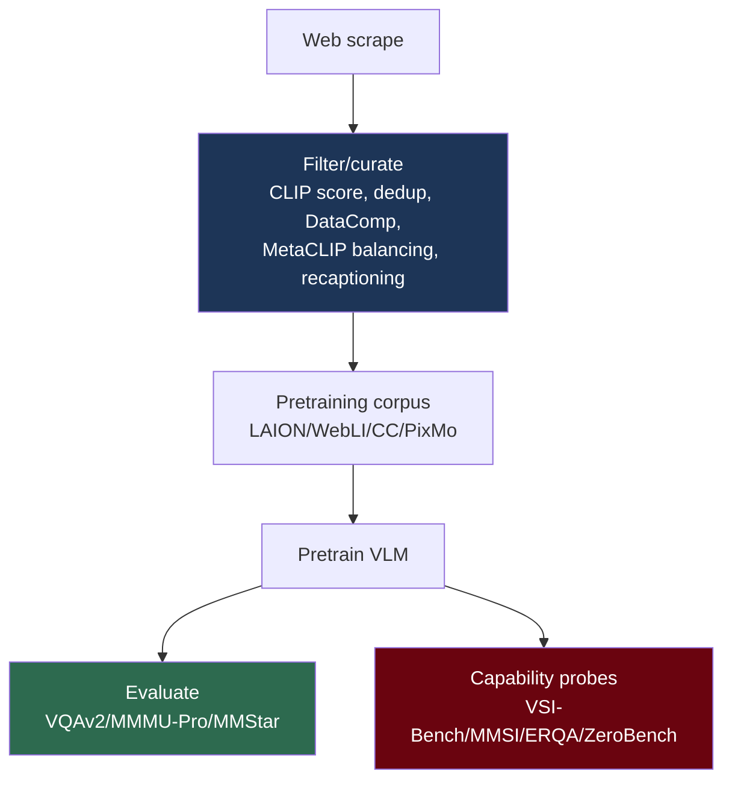

# Multimodal Datasets

> **Last Updated:** October 2026
> **Level:** Intermediate
> **Related Sections:**
> - [Large Vision-Language Models](../05_multimodal_vision_language/02_large_vision_language_models.md)
> - [Core Datasets](./00_core_datasets.md)
> - [Evaluation Metrics](./04_evaluation_metrics.md)
> - [Scaling Laws in Vision](../12_research_frontier_2024_2026/01_scaling_laws_vision.md)

> **🆕 October 2026 update:**
> - **MMMU is effectively saturated.** On the official leaderboard, GPT-5.1 reaches 85.4 on MMMU-val (Nov 2025), between the human-expert medium (82.6) and high (88.6) references. Frontier labs now report **MMMU-Pro** instead: Gemini 3 Pro 81.0, GPT-5.4 Thinking 81.2 (82.1 with tools), all author-reported. MMMU **test-set answers were publicly released in Feb 2026**, so test scores are no longer held out.
> - Added **spatial and embodied reasoning benchmarks**: VSI-Bench, MMSI-Bench (ICLR 2026; best model Gemini 3 Pro 49.2% vs human 97.2%) and Google DeepMind's ERQA.
> - Added **"anti-saturation" and contamination-aware benchmarks**: MMStar (vision-indispensable samples, leakage metrics) and ZeroBench. ZeroBench started near 0%, and the best officially evaluated model now reaches 30.0% pass@5.
> - Added new **open pretraining and instruction data**: Meta CLIP 2 (worldwide, NeurIPS 2025), PixMo (Molmo), LLaVA-OneVision-1.5 Mid-Training-85M, Molmo2 data and LLaVA-OneVision-2 video/spatial data (2026).
> - Refreshed the benchmark snapshot table with late-2025/2026 frontier numbers (image, chart, video).

---

## Overview

Multimodal datasets—paired image-text (and increasingly video-text and interleaved) corpora—are the fuel of the vision-language era. Their scale and quality determine the capabilities of every model from CLIP to GPT-4o (see [Large Vision-Language Models](../05_multimodal_vision_language/02_large_vision_language_models.md)). Two distinct dataset categories serve different stages: **web-scale pretraining corpora** (LAION-5B, WebLI, DataComp) provide the billions of noisy image-text pairs needed for contrastive and generative pretraining, while **curated benchmark datasets** (VQAv2, GQA, MMMU, MMBench) provide the cleaner, annotated evaluations that measure progress. The defining tension of this subfield—established empirically by DataComp and MetaCLIP—is that **data quality and curation often matter more than raw quantity** (see [Scaling Laws in Vision](../12_research_frontier_2024_2026/01_scaling_laws_vision.md)).

A critical, often-underappreciated issue is that the largest pretraining corpora are web-scraped and therefore carry noise, bias, duplication, NSFW content, and copyright/privacy concerns. LAION-5B's temporary withdrawal over problematic content underscored that dataset governance is now a first-order research and ethical concern, not an afterthought. This file surveys the major pretraining corpora and evaluation benchmarks, their scale and construction, and the open problems of curation, contamination, and governance.

By late 2026 the evaluation side of this field is defined by a **benchmark half-life problem**. MMMU went from GPT-4V at 56% (Nov 2023) to above the human-expert-medium reference in about two years. ZeroBench, explicitly designed to be "impossible", saw 70% of its questions solved at least once in under two years. Two responses have emerged. One is *harder, vision-indispensable* suites (MMMU-Pro, MMStar, ZeroBench, CharXiv). The other is *capability-specific* suites in areas where frontier models still fail badly, notably **spatial and embodied reasoning** (VSI-Bench, MMSI-Bench, ERQA), where the best models remain about 50 points below humans. On the data side, fully open recipes (PixMo, LLaVA-OneVision-1.5/2, Molmo2, PerceptionLM) now release their pretraining and instruction corpora, which reduces the field's dependence on distillation from proprietary models.

---

## Web-Scale Pretraining Corpora

- **LAION-400M / LAION-5B** [Schuhmann2022] — open CLIP-filtered image-text pairs (400M / 5.85B); the corpus behind open CLIP and Stable Diffusion. Influential but raised content-governance issues (temporarily taken down for re-filtering).
- **Conceptual Captions (CC3M / CC12M)** — Google's cleaned, alt-text-derived image-caption pairs (3M / 12M); higher quality, smaller scale.
- **WebLI** (Google) — ~10B+ multilingual image-text pairs behind PaLI/SigLIP (not public).
- **DataComp** [Gadre2023] — not a fixed dataset but a *benchmark for data curation*: a fixed candidate pool with filtering tracks, demonstrating curation beats scale.
- **WebVid / HowTo100M / VideoCC** — large video-text corpora for video-language pretraining (see [Video Datasets](./01_video_datasets.md)).
- **Meta CLIP 2 (worldwide)** [Chuang2025] (Jul 2025; NeurIPS 2025 spotlight) — extends MetaCLIP's metadata-balanced curation from English-only to *worldwide*, multilingual web data. It shows that English and non-English data can benefit each other rather than trading off. Models are released in open_clip and Hugging Face; the raw corpus is not.
- **Recap-DataComp-1B** [Li2024] — DataComp-1B recaptioned with a LLaMA-3-based captioner. A representative of the *synthetic re-captioning* trend, now standard in both CLIP and text-to-image pretraining.
- **PixMo** [Deitke2025] (Ai2, Nov 2024) — the open data behind Molmo, collected *without distillation from proprietary VLMs*. It includes PixMo-Cap (dense captions averaging ~200 words), PixMo-Points (pointing/counting), PixMo-AskModelAnything, PixMo-Docs (synthetic charts and documents) and PixMo-Clocks. **Molmo2** (2026) extends the release to video, multi-image pointing and tracking data.
- **LLaVA-OneVision-1.5 / -2 data** (EvolvingLMMs-Lab, 2025–2026) — a fully open stack with an **85M-sample mid-training set** and instruction data (OV-1.5, Sep 2025), plus video-caption and *spatial* datasets released with LLaVA-OneVision-2 (Apr 2026).

## Evaluation Benchmarks

- **VQAv2** [Goyal2017] — visual question answering with balanced answer pairs to counter language priors; the standard VQA benchmark.
- **GQA** — compositional VQA from scene graphs, testing reasoning over relations.
- **Visual Genome** — dense annotations: objects, attributes, relationships, region captions; basis for scene-graph and grounding work.
- **COCO Captions** — 5 captions per image over MS-COCO; the captioning/retrieval standard.
- **MMMU** [Yue2024] — massive multi-discipline multimodal understanding (college-level), the hard reasoning benchmark for modern LMMs. It has 11.5K questions (150 dev / 900 val / 10.5K test) across 30 subjects and 183 subfields. **Test answers were released in Feb 2026**, so local test evaluation is possible but contamination can no longer be ruled out.
- **MMMU-Pro** [Yue2025] (ACL 2025) — a hardened MMMU. It filters out text-answerable questions, expands the candidate options, and adds a *vision-only* setting in which the question is embedded in an image. Release-era models scored 16.8–26.9%. It is the MMMU variant frontier labs report as of 2026.
- **MMBench** — systematically constructed multiple-choice multimodal benchmark with circular evaluation; **MathVista** (visual math), **DocVQA** (documents), **TextVQA** (scene text), **POPE** (hallucination) round out the LMM evaluation suite.
- **MMStar** [Chen2024] (NeurIPS 2024) — 1,500 human-selected *vision-indispensable* samples, filtered from 22,401 candidates drawn from existing benchmarks. It was motivated by two findings: many benchmark questions are answerable without the image, and benchmark data leaks into LLM/LVLM training. It introduces **multi-modal gain (MG)** and **multi-modal leakage (ML)** metrics.
- **ZeroBench** [Roberts2025] (ICML 2026) — 100 manually curated visual-reasoning questions calibrated to be beyond frontier models at release, plus a canary string for training-data filtering. As of the latest official evaluations, 70% of questions have been solved at least once. The best model reaches **30.0% pass@5** but only **13.0% pass^5** (correct in all five samples), a large gap between capability and reliability.
- **CharXiv** — realistic scientific-chart understanding. Its reasoning-question score (CharXiv-RQ) is a standard frontier metric, with Gemini 3 Pro at 81.4 (self-reported, Nov 2025).
- **Spatial / embodied reasoning suites:**
  - **VSI-Bench** [Yang2025a] (CVPR 2025) — video-based visual-spatial intelligence on 3D-scanned scenes (see [Video Datasets](./01_video_datasets.md)).
  - **MMSI-Bench** [Yang2025c] (ICLR 2026, Shanghai AI Lab) — 1,000 fully human-designed multi-image spatial-reasoning MCQs, each with a step-by-step reasoning trace, drawn from driving, robot manipulation and scene-scan imagery. Leaderboard: human 97.2%, **Gemini 3 Pro 49.2%**, GPT-5 41.9%, random 25%. Most open-source models score near chance.
  - **ERQA** (Google DeepMind, Mar 2025) — an *embodied reasoning* multiple-choice benchmark of interleaved images and text, released with Gemini Robotics. It covers spatial reasoning and world knowledge in robotics contexts and is used as a standard axis for embodied-reasoning VLMs such as Gemini Robotics-ER.

---

## Key Datasets

| Dataset | Authors/Org | Year | Scale | Purpose |
|---------|-------------|------|-------|---------|
| LAION-5B | Schuhmann et al. | 2022 | 5.85B pairs | Open CLIP/diffusion pretraining |
| Conceptual Captions | Sharma et al. | 2018 | 3M/12M | Cleaner caption pretraining |
| DataComp | Gadre et al. | 2023 | benchmark | Data-curation evaluation |
| VQAv2 | Goyal et al. | 2017 | 1.1M QA | Balanced VQA |
| Visual Genome | Krishna et al. | 2017 | 108K images | Dense scene-graph annotations |
| MMMU | Yue et al. | 2024 | 11.5K Q | College-level multimodal reasoning |
| MMMU-Pro | Yue et al. | 2025 | filtered MMMU + vision-only setting | Hardened MMMU (text-shortcut-free) |
| MMStar | Chen et al. | 2024 | 1,500 Q | Vision-indispensable, leakage-aware eval |
| ZeroBench | Roberts et al. | 2025 | 100 Q | "Impossible" visual reasoning; pass@5 / pass^5 |
| MMSI-Bench | Yang et al. (Shanghai AI Lab) | 2025 | 1,000 Q | Multi-image spatial reasoning |
| ERQA | Google DeepMind | 2025 | MCQ set | Embodied reasoning for robotics |
| Meta CLIP 2 | Chuang et al. (Meta) | 2025 | worldwide web pairs (recipe) | Multilingual CLIP curation |
| PixMo | Deitke et al. (Ai2) | 2024 | multiple sets | Non-distilled open VLM data |
| LLaVA-OneVision-1.5 Mid-Training | EvolvingLMMs-Lab | 2025 | 85M samples | Fully open LMM mid-training |

---

## Benchmark Snapshot (indicative LMM scores)

| Benchmark | What it tests | Strong model (approx.) |
|-----------|---------------|------------------------|
| MMMU (val) | Expert reasoning | ~85 (GPT-5.1, Nov 2025); human expert 82.6–88.6; ~70 in 2024 (InternVL2.5 / GPT-4o) |
| MMMU-Pro | Text-shortcut-free expert reasoning | ~81–82 (Gemini 3 Pro 81.0; GPT-5.4 Thinking 81.2, 82.1 w/ tools); human expert 80.8–85.4 |
| MMBench | Broad perception | ~85–88 (2024–25; near-saturated) |
| MathVista | Visual math | ~90 (Kimi K2.5 90.1; Gemini 3 Pro 89.8 as re-evaluated by Moonshot); ~63–72 in 2024 |
| CharXiv (RQ) | Scientific-chart reasoning | ~81–82 (Gemini 3 Pro 81.4; GPT-5.2 82.1) |
| DocVQA | Document reading | ~92–96 (saturated) |
| ZeroBench (main) | "Impossible" visual reasoning | 30.0 pass@5 / 13.0 pass^5 (best official, 2026) |
| MMSI-Bench | Multi-image spatial reasoning | 49.2 (Gemini 3 Pro) vs human 97.2 |
| Video-MMMU | Knowledge from lecture video | ~87.6 (Gemini 3 Pro) |
| POPE | Hallucination | high but imperfect |

*Scores approximate, version- and protocol-dependent. Most 2025–2026 frontier numbers are self-reported by model developers (often with "thinking" or tool use enabled) and are not independently reproduced.*

---

## Pros & Cons

| Aspect | Pros | Cons |
|--------|------|------|
| Web-scale corpora | Enable foundation-scale pretraining | Noise, bias, NSFW, copyright/privacy |
| Curated benchmarks | Clean, comparable evaluation | Saturation, contamination, format-overfit |
| Compositional benchmarks (GQA/MMMU) | Test reasoning, not memorization | Costly to build; still gameable |
| Vision-indispensable / "impossible" suites (MMStar, MMMU-Pro, ZeroBench) | Remove text shortcuts; long headroom at release | Small (100–1,500 items) → high variance; headroom erodes within ~1–2 years |
| Spatial/embodied suites (VSI-Bench, MMSI, ERQA) | Expose a large, persistent human–model gap | Narrow scene distributions; MCQ format allows guessing (needs circular eval) |
| Fully open data recipes (PixMo, LLaVA-OV, Molmo2) | Reproducible; avoid proprietary distillation | Still smaller than closed corpora; synthetic portions inherit generator biases |

---

## Open Problems & Research Gaps

- **Data governance.** Consent, copyright, privacy, and harmful content in web-scale corpora are unresolved (LAION withdrawal).
- **Curation theory.** DataComp shows curation matters but lacks a predictive theory of *what* to keep (see [Scaling Laws in Vision](../12_research_frontier_2024_2026/01_scaling_laws_vision.md)). Meta CLIP 2 adds the multilingual dimension: balancing concepts across languages without degrading English performance.
- **Benchmark contamination.** Test data leaking into pretraining inflates scores; clean held-out evaluation is hard. The Feb 2026 public release of MMMU test answers removes the last held-out MMMU split. Canary strings (ZeroBench) and leakage metrics (MMStar's ML) are only partial mitigations.
- **Saturation.** VQAv2/COCO are near-saturated; harder, robust benchmarks (MMMU) age quickly too. MMMU-val is now within the human-expert band, and frontier labs have dropped it in favour of MMMU-Pro, which is itself approaching the human-expert range.
- **Reliability vs. capability.** ZeroBench's gap between pass@5 (30%) and pass^5 (13%) shows that single-sample accuracy hides large run-to-run inconsistency. Benchmark reports rarely include variance or all-k success.
- **Spatial intelligence gap.** On multi-image and video spatial reasoning (MMSI-Bench, VSI-Bench), the best models remain about 50 points below humans, and most open models are near chance. Whether this gap closes through scale, spatial training data (VSI-590K, LLaVA-OV-2 spatial) or explicit 3D representations is open.
- **Cultural/linguistic bias.** English- and Western-centric data skews model behavior.
- **Multimodal coverage.** Beyond image-text, paired video/audio/3D-text data remains scarce (see [3D & Robotics Datasets](./02_3d_and_robotics_datasets.md)).
- **Synthetic data quality.** As model-generated captions and images increasingly enter training corpora, controlling for model-collapse effects and verifying synthetic-data fidelity is an emerging, unsolved concern.
- **Dynamic benchmarks.** Static leaderboards age quickly against fast-improving models; live, contamination-resistant, periodically-refreshed evaluation remains an open infrastructure problem.
- **Self-reported numbers.** Most frontier results are author-reported under heterogeneous settings (thinking budget, tools, frame counts). Independent re-evaluations, for example the starred entries in third-party model reports, often differ by several points.

---

## Further Reading

- [LAION-5B (arXiv:2210.08402)](https://arxiv.org/abs/2210.08402) — open web-scale image-text
- [DataComp (arXiv:2304.14108)](https://arxiv.org/abs/2304.14108) — data curation benchmark
- [VQAv2 (arXiv:1612.00837)](https://arxiv.org/abs/1612.00837) — balanced visual QA
- [MMMU (arXiv:2311.16502)](https://arxiv.org/abs/2311.16502) — multi-discipline multimodal benchmark
- [Visual Genome (arXiv:1602.07332)](https://arxiv.org/abs/1602.07332) — dense annotations
- [MMMU / MMMU-Pro repository and leaderboard data](https://github.com/MMMU-Benchmark/MMMU) — [MMMU-Pro (arXiv:2409.02813)](https://arxiv.org/abs/2409.02813)
- [MMStar (arXiv:2403.20330)](https://github.com/MMStar-Benchmark/MMStar) — vision-indispensable evaluation and leakage metrics
- [ZeroBench (arXiv:2502.09696)](https://github.com/jonathan-roberts1/zerobench) — "impossible" visual benchmark, pass@k / pass^k
- [MMSI-Bench (arXiv:2505.23764)](https://github.com/InternRobotics/MMSI-Bench) — multi-image spatial intelligence
- [ERQA](https://github.com/embodiedreasoning/ERQA) — embodied reasoning QA (Gemini Robotics)
- [Meta CLIP 2 (arXiv:2507.22062)](https://github.com/facebookresearch/MetaCLIP) — worldwide CLIP data curation
- [Molmo / PixMo](https://github.com/allenai/molmo) · [Molmo2 (arXiv:2601.10611)](https://github.com/allenai/molmo2) — open VLM data
- [LLaVA-OneVision-1.5 / 2 (arXiv:2509.23661)](https://github.com/EvolvingLMMs-Lab/LLaVA-OneVision-1.5) — fully open LMM training data
