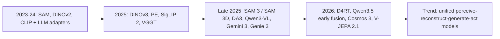

# 2024–2026 Computer Vision Research: State of the Field

> **Last Updated:** October 2026
> **Level:** Research Frontier
> **Related Sections:**
> - [Robotics & Embodied AI Overview](../06_robotics_and_embodied_ai/00_overview_roadmap.md)
> - [Future Trends](./07_future_trends.md)
> - [VLA Models](../06_robotics_and_embodied_ai/01_vla_models.md)
> - [World Models for Robotics](../06_robotics_and_embodied_ai/02_world_models.md)

> **🆕 October 2026 update:**
> - New section **"What Changed: Mid-2025 → October 2026"** covering DINOv3, SAM 3 / SAM 3.1 / SAM 3D, Depth Anything 3, feed-forward 3D/4D reconstruction (VGGT → D4RT), frontier MLLMs (GPT-5, Gemini 3, Qwen3-VL, Qwen3.5), VLAs (π₀.₅, π\*₀.₆, Gemini Robotics 1.5, GR00T N1.6/N1.7) and world models (Genie 3, Waymo World Model, Marble, Cosmos 3, V-JEPA 2.1).
> - New **Conference Highlights** section: CVPR 2026 (Denver; Best Paper D4RT, Best Student Paper TRELLIS.2, honorable mentions NitroGen and SAM 3D) and ECCV 2026 (Malmö; reported Best Paper "Heat Kernel Textures").
> - Open-source model table extended with 17 new 2025–2026 releases; Key Papers and Benchmark tables extended.
> - Investment/industry context updated through 2026 (Skild AI, Apptronik, World Labs, AMI Labs, Physical Intelligence, Figure).
> - Corrected an outdated claim that 2024-era MLLMs exceeded 80% on MMMU (frontier models crossed 80% only in 2025).

---

## Overview

The period from 2024 to 2026 represents the most consequential inflection point in computer vision since the ImageNet moment of 2012. The defining shift is not merely one of scale but of *paradigm*: the field has moved from training task-specific models—each excelling at detection, segmentation, depth, or tracking in isolation—toward training universal visual representations that can be prompted, composed, and deployed across an open-ended space of perception and control tasks. Three distinct but converging battlegrounds characterize this moment: (1) **Vision-Language Models (VLMs)** for open-world perception, exemplified by the explosion of CLIP-family models and multi-modal LLMs; (2) **Vision-Language-Action (VLA) models** for physical control, where language-conditioned policies are displacing classical robot pipelines; and (3) **World Models** for simulation and planning, where generative video models are beginning to serve as differentiable physics engines for training embodied agents.

The catalyst for all three battlegrounds is a shared infrastructure advance: the emergence of very large, openly available foundation models that can be fine-tuned or composed for downstream tasks at a fraction of the original training cost. DINOv2 [Oquab2023] established that purely self-supervised ViT encoders trained on curated large-scale image data could match or exceed supervised representations across nearly every vision benchmark. SAM [Kirillov2023] demonstrated that a single promptable segmentation model trained on 1 billion masks could generalize zero-shot to domains its creators never imagined. SAM2 [Ravi2024] extended this to video, enabling real-time prompted tracking through occlusion. Depth Anything V2 [Yang2024] showed that monocular depth—long considered intractable without metric-scale supervision—could be solved to near-lidar quality by combining labeled data with massive pseudo-labeled unlabeled imagery. Collectively, these models define the *any-model paradigm*: a new class of foundation models that operate across arbitrary inputs via lightweight prompting rather than task-specific retraining.

From mid-2025 to late 2026 these trends consolidated into a second generation. DINOv3 [Simeoni2025] scaled self-supervised learning to a 7B-parameter ViT trained on 1.7B images; SAM 3 [Carion2025] turned "segment anything" into "segment every instance of a *concept*" from a noun phrase or exemplar; feed-forward geometry transformers—VGGT [Wang2025] (CVPR 2025 Best Paper), Depth Anything 3 [Lin2025], MapAnything, and D4RT [Zhang2025] (CVPR 2026 Best Paper)—replaced much of the classical SfM/MVS/tracking pipeline with a single network forward pass. Frontier MLLMs (GPT-5, Gemini 3) crossed 80% on MMMU-class benchmarks, while open-weight families (Qwen3-VL, InternVL3.5, Qwen3.5) moved to MoE backbones and, in Qwen3.5's case, early-fusion multimodal pre-training. Interactive world models went from research demos (Genie 2) to real-time products (Genie 3, World Labs Marble) and industrial simulators (Waymo World Model, NVIDIA Cosmos 3).

The economic context cannot be ignored. The year 2024–2025 saw more than $10 billion invested in robotics and embodied AI startups globally, with robotics-focused funding in 2025 alone exceeding the full-year 2024 total; TechCrunch put robotics startup funding at nearly $14B in 2025, up from $8.2B in 2024. Physical Intelligence (pi.ai) raised a $600M Series B (Nov 2025), valuing the company at $5.6B, on the strength of its π₀ [BlackEtAl2024] generalist robot policy. Figure AI completed a $1B+ Series C at a $39B post-money valuation (Sep 2025). NVIDIA placed a comprehensive platform bet through Isaac GR00T N1 [NVIDIA2025], the first openly released humanoid robot foundation model, and the Cosmos world foundation model family for physics-aware synthetic data generation. The pace accelerated in 2026: Skild AI announced a $1.4B raise at a valuation above $14B (Jan 2026, reported by TechCrunch); Apptronik raised $520M at a ~$5B valuation (Feb 2026, reported by CNBC); Fei-Fei Li's World Labs closed a $1B round with Autodesk, NVIDIA and AMD participating (Feb 2026, reported); and Yann LeCun's Paris-based **AMI Labs**, founded after his November 2025 departure from Meta to pursue JEPA-style world models, raised $1.03B at a $3.5B pre-money valuation (Mar 2026, reported by TechCrunch)—described as Europe's largest-ever seed round. These investments reflect a consensus that general-purpose robotic intelligence—long regarded as decades away—is now a near-term engineering problem, not a fundamental science problem, contingent on getting visual representations and world models right. It also reflects a notable bet *against* the LLM-only path: two of the largest 2026 rounds (World Labs, AMI Labs) went to "world model" companies.

---

## The Three Battlegrounds

### 1. VLMs for Open-World Perception

The CLIP-family has undergone dramatic scaling. EVA-CLIP-18B [Sun2024], with 18 billion parameters, is the largest openly released contrastive vision-language model and achieves 80.7% zero-shot top-1 accuracy averaged across 27 classification benchmarks. SigLIP 2 [Zhai2025], Google's successor to the sigmoid-loss contrastive encoder, adds multilingual support (109 languages), dense feature improvements, and strong open-vocabulary localization. DFN-5B—trained on a 5B-image filtered subset of 43B noisy web pairs via Data Filtering Networks [Fang2023]—showed that filtering quality dominates raw quantity. MetaCLIP [Xu2024] demonstrated that curating training data against CLIP's own concept distribution—rather than opaque proprietary filtering—allows 72.4% ImageNet zero-shot at 1B scale while beating OpenAI CLIP. In 2025, Meta's **Perception Encoder** [Bolya2025] (PE-Core-G: 85.4% ImageNet zero-shot) showed that a single contrastively trained encoder contains strong dense and language-aligned features in its *intermediate* layers, and **Meta CLIP 2** [Chuang2025] (NeurIPS 2025 spotlight) extended curation to worldwide, multilingual web data.

The emergence of multi-modal large language models (MLLMs) that fuse strong language model backbones with visual encoders has created a new SOTA tier. 2024-era models (GPT-4V, Gemini 1.5 Pro, Claude 3.5, InternVL, LLaVA-NeXT, Qwen-VL) moved MMMU (Massive Multi-discipline Multimodal Understanding)—a benchmark that was near-random for CLIP-family models—from ~56% (GPT-4V) to ~70%; in 2025 frontier models crossed 80% (GPT-5: 84.2%), and attention shifted to harder successors such as MMMU-Pro and Video-MMMU (Gemini 3 Pro: 81.0% and 87.6%). The key architectural pattern of the 2024 generation is a frozen or lightly tuned vision encoder (typically DINOv2 + SigLIP) feeding into a large language model through a learned projector (MLP or Q-Former); the 2025–2026 generation increasingly trains the vision encoder jointly, uses MoE language backbones, and—in Qwen3.5—adopts early-fusion multimodal pre-training (see [Multimodal LLMs 2025–2026](./03_multimodal_llm_2025_2026.md)).

### 2. VLAs for Physical Control

Vision-Language-Action models represent the most direct application of the VLM revolution to robotics. The canonical architecture takes language instruction tokens and image tokens as input and outputs continuous or discretized robot actions. RT-2 [BrohmanEtAl2023] was the inflection point, showing that co-fine-tuning a 55B PaLI-X VLM on robot trajectory data produced emergent reasoning—the robot could navigate by counting objects described in a scene. OpenVLA [KimEtAl2024], a 7B-parameter open-source alternative built on Llama 2 with DINOv2+SigLIP visual encoder, demonstrated that open-source VLAs trained on Open X-Embodiment (970K trajectories) could outperform RT-2 on standard manipulation benchmarks.

π₀ [BlackEtAl2024] by Physical Intelligence pushed further: a flow-matching diffusion VLA trained on diverse dexterous robot hardware (single-arm, dual-arm, mobile manipulators) using PaliGemma 2B as the language backbone. It produces fluid, compliant motions that previous autoregressive discrete-action VLAs could not. Octo [GhoshEtAl2024], published at RSS 2024, is an open-source transformer policy trained on 800K trajectories that can be fine-tuned to new robot platforms in hours on a single GPU. GR00T N1 [NVIDIA2025], released March 2025, introduces a dual-system architecture: a slow VLM "System 2" for reasoning over language and scene, feeding a fast diffusion-transformer "System 1" for real-time action generation; the 2.2B-parameter model can sample 16 actions in 63.9 ms on an L40 GPU.

The 2025–2026 VLA generation emphasizes open-world generalization and learning from experience. **π₀.₅** [PI2025] (open-sourced in `openpi`, Sep 2025) uses co-training on heterogeneous data and "knowledge insulation" to generalize to unseen homes; **π\*₀.₆** (Nov 2025) adds RL from autonomous experience and corrections (the RECAP recipe). Google DeepMind's **Gemini Robotics 1.5 / Gemini Robotics-ER 1.5** (Sep 2025) split embodied reasoning from motor control and introduced "thinking before acting". NVIDIA iterated GR00T to **N1.6** (Eagle VLM backbone, 32-layer diffusion action head) and **N1.7** (3B parameters, Cosmos-Reason2-2B backbone with Qwen3-VL architecture, 132-D state/action space, pre-training augmented with 20K hours of egocentric human video). See [VLA & Embodied AI 2025–2026](./04_vla_embodied_2025_2026.md).

### 3. World Models for Simulation and Planning

World models—generative models of environment dynamics that can be used for planning and data augmentation—crossed a threshold of visual realism and physical plausibility in 2024–2025. Genie 2 [ParmarEtAl2024], announced by Google DeepMind in December 2024, uses an autoregressive latent diffusion model to generate interactive 3D environments from a single image, maintaining physical consistency for up to one minute, enabling rapid prototyping of RL environments. NVIDIA Cosmos [NVIDIA2025], launched at CES 2025 and updated through CoRL 2025, provides a family of open world foundation models for physics-aware video prediction conditioned on text, image, video, and robot action data; Cosmos Predict 2.5 (Oct 2025; 2B and 14B) unifies Text2World/Image2World/Video2World and enables multi-view outputs and long-horizon autoregressive generation. V-JEPA 2 [Meta2025] takes a non-generative route: a 1.2B-parameter latent-space predictive model pre-trained on 1 million hours of video that achieves 77.3% top-1 on Something-Something v2 and enables zero-shot robot planning via model-predictive control in latent space.

Since mid-2025: **Genie 3** (Google DeepMind, Aug 2025) generates navigable worlds in real time (720p, 24 fps) with minutes of visual consistency and promptable world events; it was opened to Google AI Ultra subscribers as **Project Genie** (Jan 2026) and post-trained by Waymo into the **Waymo World Model** (Feb 2026), which generates camera *and* lidar streams for rare-event driving simulation. World Labs launched **Marble** (late 2025), a commercial product that produces persistent, exportable 3D worlds (Gaussian splats/meshes) from text, images or video. NVIDIA released **Cosmos 3** (May 2026), a single architecture with a "Reasoner" (text+vision→text) and a "Generator" (text, vision, sound, action → vision, sound, action) in 4B/16B/64B sizes. Meta released **V-JEPA 2.1** (Mar 2026; 80M–2B) with temporally consistent dense features. Video generation models with synchronized audio—**Veo 3** (May 2025) / **Veo 3.1** (Oct 2025) and **Sora 2** (Sep 2025)—narrowed the gap between "video generator" and "world simulator", although physics fidelity remains contested. See [World Models for Robotics](../06_robotics_and_embodied_ai/02_world_models.md).

---

## What Changed: Mid-2025 → October 2026

| Area | Mid-2025 state | October 2026 state | Representative evidence |
|---|---|---|---|
| Visual backbones | DINOv2 / SigLIP as default encoders | DINOv3 (7B teacher, distilled 21M–840M ViTs and ConvNeXts), PE, SigLIP 2, Meta CLIP 2 | [Simeoni2025], [Bolya2025], [Chuang2025] |
| Segmentation | Visual prompts (points/boxes/masks) | Concept prompts (noun phrase or exemplar) → all instances, images + video; SAM 3.1 multiplexed multi-object tracking (Mar 2026) | SAM 3 [Carion2025] |
| 3D from images | Optimization (SfM/MVS, per-scene NeRF/3DGS) dominant | Feed-forward any-view geometry (VGGT, DA3, MapAnything) and single-image object/body 3D (SAM 3D) | CVPR 2025 & 2026 awards |
| 4D / dynamic scenes | Separate depth, tracking, pose models | Single query-based encoder–decoder for depth, correspondence and pose (D4RT, up to 300× faster than prior work per authors) | CVPR 2026 Best Paper |
| 3D generation | TRELLIS (2024) | TRELLIS.2 (4B, O-Voxel, up to 1536³ with PBR materials) | CVPR 2026 Best Student Paper |
| MLLMs | Qwen2.5-VL / InternVL2.5 ≈ 70% MMMU | GPT-5 84.2% MMMU; Gemini 3 Pro 81.0% MMMU-Pro; Qwen3-VL (256K→1M context), InternVL3.5, Qwen3.5 (early fusion) | Official model reports |
| VLAs | π₀, GR00T N1, OpenVLA | π₀.₅ (open), π\*₀.₆ (RL from experience), Gemini Robotics 1.5, GR00T N1.6/N1.7 | See [04](./04_vla_embodied_2025_2026.md) |
| World models | Genie 2, Cosmos 1, V-JEPA 2 | Genie 3 / Project Genie, Waymo World Model, Marble, Cosmos Predict 2.5 → Cosmos 3, V-JEPA 2.1 | Lab announcements |
| Agents in pixels | Game agents mostly task-specific | NitroGen: open 500M DiT gamepad-action foundation model trained from internet gameplay video | CVPR 2026 Honorable Mention |

---

## The Open-Source Moment

A defining characteristic of 2024–2026 is that the most impactful models are openly released:

| Model | Type | Release | Parameters |
|---|---|---|---|
| DINOv2 [Oquab2023] | Self-supervised ViT | Apr 2023 | 1.1B (ViT-g) |
| SAM [Kirillov2023] | Promptable Segmentation | Apr 2023 | ~630M |
| SAM2 [Ravi2024] | Video Segmentation | Aug 2024 | ~230M–450M |
| Depth Anything V2 [Yang2024] | Monocular Depth | Jun 2024 | 25M–1.3B |
| OpenVLA [KimEtAl2024] | Vision-Language-Action | Jun 2024 | 7B |
| Octo [GhoshEtAl2024] | Robot Policy | May 2024 | 93M |
| GR00T N1 [NVIDIA2025] | Humanoid VLA | Mar 2025 | 2.2B |
| VGGT [Wang2025] | Feed-forward 3D reconstruction | Mar 2025 | 1B |
| Perception Encoder [Bolya2025] | Vision encoder (CLIP / spatial / lang) | Apr 2025 | T/16 – G/14 family |
| BAGEL [Deng2025] | Unified understanding + generation | May 2025 | 14B total / 7B active (MoT) |
| V-JEPA 2 [Meta2025] | World Model | Jun 2025 | 1.2B |
| DINOv3 [Simeoni2025] | Self-supervised ViT | Aug 2025 | 6.7B (ViT-7B) + distilled 21M–840M |
| InternVL3.5 [Wang2025b] | MLLM | Aug 2025 | 1B – 241B-A28B (MoE) |
| MapAnything | Feed-forward metric 3D reconstruction | Sep 2025 | — (Apache-2.0 and CC-BY-NC variants) |
| π₀.₅ (openpi) [PI2025] | VLA | Sep 2025 (weights) | PaliGemma-based |
| Qwen3-VL [Bai2025b] | MLLM | Sep–Oct 2025 | 2B – 235B-A22B (MoE) |
| Cosmos Predict 2.5 | World foundation model | Oct 2025 | 2B / 14B |
| Depth Anything 3 [Lin2025] | Any-view depth & pose | Nov 2025 | 0.08B – 1.40B |
| SAM 3 [Carion2025] | Concept segmentation & tracking | Nov 2025 | 848M |
| SAM 3D Objects / Body | Single-image 3D objects / human mesh | Nov 2025 | — |
| TRELLIS.2 [Xiang2025] | Image-to-3D generation | Dec 2025 | 4B |
| NitroGen [Magne2026] | Generalist gaming agent | Jan 2026 | 500M |
| Qwen3.5 | Early-fusion multimodal LLM | Feb 2026 | 0.8B – 397B-A17B (MoE) |
| V-JEPA 2.1 | Video world model / dense features | Mar 2026 | 80M – 2B |
| Cosmos 3 | Unified world reasoner + generator | May 2026 | 4B / 16B / 64B |
| GR00T N1.7 | Humanoid VLA | 2026 | 3B |

This open-source moment is not altruistic—it reflects a strategic bet that the value in this stack lies in the platform and deployment layer, not the model weights themselves. Meta, NVIDIA, and Google DeepMind release weights to cultivate ecosystems; Physical Intelligence and Figure AI keep their best models proprietary to defend competitive moats in hardware-integrated deployment. Two nuances emerged in 2025–2026: (1) "open" increasingly means *open weights under custom licenses* (e.g., the DINOv3 License and SAM License, gated downloads, separate commercial checkpoints for VGGT and MapAnything) rather than OSI-approved licenses; and (2) Chinese labs (Alibaba Qwen, Shanghai AI Lab InternVL, Zhipu GLM-V, OpenBMB MiniCPM-V, ByteDance Seed) now supply most of the strongest open-weight MLLMs, while Meta and NVIDIA dominate open perception, 3D and world-model releases. Physical Intelligence partially opened its stack (π₀, π₀-FAST, π₀.₅ in `openpi`) while keeping π\*₀.₆ proprietary.

---

## Conference Highlights 2025–2026

| Venue | Facts | Highlights |
|---|---|---|
| **CVPR 2025** (Nashville) | — | Best Paper: *VGGT: Visual Geometry Grounded Transformer* (Oxford VGG + Meta) — established feed-forward 3D reconstruction as a frontier topic |
| **ICLR 2026** | — | SAM 3 [Carion2025] accepted |
| **CVPR 2026** (Denver, 3–7 Jun 2026) | Record 16,092 submissions (+24% vs. 2025); ~4,089 papers presented (~25% acceptance) | **Best Paper:** *Efficiently Reconstructing Dynamic Scenes One D4RT at a Time* (Google DeepMind, UCL, Oxford). **Best Student Paper:** *Native and Compact Structured Latents for 3D Generation* (TRELLIS.2; Tsinghua & Microsoft). **Best Paper Honorable Mentions:** *NitroGen: An Open Foundation Model for Generalist Gaming Agents*; *SAM 3D: 3Dfy Anything in Images*. **Best Student Paper HM:** *ChordEdit: One-Step Low-Energy Transport for Image Editing* |
| **ECCV 2026** (Malmö, 8–12 Sep 2026) | Reported: 10,473 valid submissions, 2,834 accepted (27.1%), 163 orals; 90+ workshops; keynotes by Kristen Grauman, Yann LeCun and Jamie Shotton | **Best Paper (reported):** *Heat Kernel Textures — the Geodesic Gaussians That Do Not Splat* (Foti, Korkmaz, Zafeiriou, Birdal; Imperial College London). Reported honorable mentions: *LSRM* (object-centric reconstruction with scaled context windows) and *Poppy* (polarization-guided surface normals). Reported Koenderink Prize (ECCV 2016 test-of-time): Perceptual Losses (Johnson, Alahi, Fei-Fei), SSD (Liu et al.), Learning without Forgetting (Li & Hoiem) |

**Reading the awards.** Two years of best papers (VGGT → D4RT) went to *feed-forward geometry*: networks that amortize what used to be per-scene optimization into a single forward pass and expose geometry through queries. The CVPR 2026 honorable mentions show the any-model recipe spreading to 3D (SAM 3D) and to action (NitroGen learns gamepad actions from internet video, an analogue of VLA pre-training from human video). ECCV 2026 again rewarded representation-level 3D work (a non-splatting, geodesic alternative to UV textures and Gaussian splatting). Submission growth (+24% at CVPR; ECCV from 8,585 in 2024 to 10,473 in 2026) continues to strain peer review.

---

## Key Papers

| Paper | Authors | Year | Venue | Key Contribution |
|---|---|---|---|---|
| Segment Anything (SAM) | Kirillov et al. | 2023 | ICCV | Promptable segmentation at scale; SA-1B dataset (1B masks, 11M images) |
| SAM 2: Segment Anything in Images and Videos | Ravi et al. | 2024 | ICLR 2025 | Extends SAM to video with streaming memory; 6× faster than SAM on images |
| Depth Anything: Unleashing the Power of Large-Scale Unlabeled Data | Yang et al. | 2024 | CVPR | Semi-supervised depth foundation model; 62M+ unlabeled images |
| Depth Anything V2 | Yang et al. | 2024 | NeurIPS | Synthetic data replaces real labels; 97.1% on DA-2K; 10× faster than diffusion methods |
| DINOv2: Learning Robust Visual Features without Supervision | Oquab et al. | 2023 | TMLR | Self-supervised ViT features that match supervised on all benchmarks |
| OpenVLA: An Open-Source Vision-Language-Action Model | Kim et al. | 2024 | CoRL | 7B open-source VLA on 970K robot demos; outperforms RT-2 |
| Octo: An Open-Source Generalist Robot Policy | Ghosh et al. | 2024 | RSS | 93M transformer policy on 800K trajectories; fine-tunable in hours |
| π₀: A Vision-Language-Action Flow Model | Black et al. | 2024 | arXiv | Flow-matching diffusion VLA; multi-robot dexterous manipulation |
| GR00T N1: An Open Foundation Model for Generalist Humanoid Robots | NVIDIA | 2025 | arXiv | Dual-system VLA for humanoids; 40% gain with synthetic+real data |
| V-JEPA 2 | Meta | 2025 | arXiv | 1.2B latent world model; 77.3% SSv2; zero-shot robot planning |
| EVA-CLIP-18B: Scaling CLIP to 18 Billion Parameters | Sun et al. | 2024 | arXiv | Largest open CLIP; 80.7% avg zero-shot on 27 benchmarks |
| SigLIP 2 | Zhai et al. | 2025 | arXiv | Multilingual CLIP (109 langs); dense feature improvements |
| VGGT: Visual Geometry Grounded Transformer | Wang et al. | 2025 | CVPR (Best Paper) | 1B feed-forward network predicting cameras, depth, point maps and tracks from 1–hundreds of views |
| Perception Encoder: The best visual embeddings are not at the output of the network | Bolya et al. | 2025 | arXiv 2504.13181 | Contrastive encoder whose intermediate layers rival specialist dense/LLM-aligned features; PE-Core-G 85.4% IN zero-shot |
| DINOv3 | Siméoni et al. | 2025 | arXiv 2508.10104 | 7B SSL ViT on 1.7B images; Gram anchoring for dense features; distilled family |
| SAM 3: Segment Anything with Concepts | Carion et al. | 2025 | ICLR 2026 | Promptable concept segmentation in images and video; SA-Co benchmark (270K concepts) |
| SAM 3D Objects / SAM 3D Body | Meta | 2025 | arXiv 2511.16624 / 2602.15989; CVPR 2026 HM | Single-image 3D object reconstruction and promptable human mesh recovery via human-in-the-loop data engine |
| Depth Anything 3: Recovering the Visual Space from Any Views | Lin et al. | 2025 | arXiv 2511.10647 | Plain-transformer depth-ray prediction; beats DA2 (mono) and VGGT (multi-view) per authors |
| Efficiently Reconstructing Dynamic Scenes One D4RT at a Time | Zhang et al. (Google DeepMind, UCL, Oxford) | 2025 | CVPR 2026 (Best Paper) | Query-based unified 4D reconstruction (depth, correspondence, pose); up to 300× faster |
| Native and Compact Structured Latents for 3D Generation (TRELLIS.2) | Xiang et al. | 2025 | CVPR 2026 (Best Student Paper) | 4B image-to-3D with O-Voxel sparse representation and PBR materials |
| NitroGen: An Open Foundation Model for Generalist Gaming Agents | Magne et al. | 2026 | CVPR 2026 (HM) | Behaviour-cloned pixel→gamepad action model from internet gameplay video |
| Qwen3-VL Technical Report | Qwen Team | 2025 | arXiv 2511.21631 | Dense + MoE MLLMs; Interleaved-MRoPE, DeepStack; 256K native context |
| Heat Kernel Textures — the Geodesic Gaussians That Do Not Splat | Foti, Korkmaz, Zafeiriou, Birdal | 2026 | ECCV 2026 (Best Paper, reported) | Heat-diffusion geodesic Gaussians on surfaces as an alternative to UV maps and splatting |

---

## Benchmark Performance

| Model | Dataset | Metric | Score | Notes |
|---|---|---|---|---|
| SAM2-L | SA-V (video) | J&F | ~82 | Zero-shot; 3× fewer clicks than prior VOS methods |
| SAM2-L | MOSE | J&F | 76.4 | Zero-shot on challenging occluded objects |
| Depth Anything V2-L | DA-2K | Accuracy | 97.1% | vs. Marigold ≤88.1%; 10× faster |
| EVA-CLIP-18B | ImageNet-1K | Zero-shot Top-1 | 80.7% (avg 27 datasets) | 18B params |
| DINOv2 (ViT-g) | ImageNet-1K | Linear probe Top-1 | 86.5% | 1.1B params, no labels |
| OpenVLA-7B | BridgeV2 / RT-2 benchmark | Task success | Outperforms RT-2 | vs. 55B RT-2 |
| Octo | WidowX manipulation | Task success | 25% above RT-1-X | Language-conditioned |
| V-JEPA 2 | Something-Something v2 | Top-1 accuracy | 77.3% | Attentive probe, no fine-tune |
| GR00T N1 | Sim manipulation (multi-embodiment) | Task success | SOTA vs. IL baselines | +40% with synthetic data |
| SigLIP 2 B/16 (256px) | ImageNet-1K | Zero-shot Top-1 | 79.1% | vs. SigLIP 76.7% |
| PE-Core-G14-448 | ImageNet-1K | Zero-shot Top-1 | 85.4% | Also 92.6% ImageNet-A [Bolya2025] |
| SAM 3 | SA-Co/Gold (image) | cgF1 | 55.7 | Human 74.0; ~75–80% of human on SA-Co |
| SAM 3 | SA-V test (video concepts) | cgF1 | 30.3 | Human 53.1 |
| V-JEPA 2-AC | Franka pick-and-place (cup) | Success | 80% | vs. Octo 10%, Cosmos 0%; zero-shot, monocular RGB |
| VGGT-1B-Commercial | Co3D | AUC@30 | 90.37 | Feed-forward camera pose |
| GPT-5 | MMMU | Accuracy | 84.2% | Closed; Aug 2025 |
| Gemini 3 Pro | MMMU-Pro / Video-MMMU | Accuracy | 81.0% / 87.6% | Closed; Nov 2025 |

---

## Pros & Cons

| Aspect | Pros | Cons |
|---|---|---|
| Universal Foundation Models | Single pretrained backbone covers detection, segmentation, depth, tracking—dramatically reducing per-task R&D | Catastrophic forgetting and task interference when fine-tuning on narrow domains; very large compute footprint |
| VLA Paradigm | Enables natural-language task specification; generalizes across robot morphologies; benefits from internet-scale pretraining | Action space tokenization remains lossy; low-frequency control limits fine dexterity; safety is poorly characterized |
| Open-Source Ecosystem | Accelerates research; reproducibility; community contributions extend models to new domains | Quality gap between open and proprietary closed models in production settings; no standardized safety audit process; growing use of restrictive custom licenses |
| World Models for RL/Planning | Unlimited synthetic data; safe exploration; latent MPC enables planning without explicit rollouts | Physical plausibility breaks down over long horizons; sim-to-real gap persists; photorealistic models are compute-prohibitive |
| Data Engines (SAM, Depth Anything) | Bootstrap labeled datasets at internet scale; reduce annotation cost by orders of magnitude | Pseudo-label noise compounds; domain gaps between synthesized and real-world distribution remain hard to quantify |
| Feed-forward 3D/4D (VGGT, DA3, D4RT) | Seconds instead of hours of per-scene optimization; unified depth/pose/tracking; strong priors for robotics and AR | Metric scale and long sequences still drift; accuracy on unusual geometry/optics trails optimization; several strongest models not publicly released (e.g., D4RT weights) |
| Concept-promptable perception (SAM 3) | Open-vocabulary detection + segmentation + tracking in one model; exhaustive instance recall | Still ~20–25% below human cgF1 on SA-Co; struggles with long, compositional referring expressions without an MLLM in the loop |

---

## Open Problems & Research Gaps

1. **Long-horizon task generalization in VLAs.** Current VLA models excel at 5–30 second manipulation primitives but fail on tasks requiring minutes of coherent multi-step execution. Neither π₀ nor OpenVLA have demonstrated reliable tabletop-to-full-kitchen task completion without human intervention. π₀.₅ (cleaning unseen homes) and π\*₀.₆ (RL from deployment experience) are partial answers, but robust hour-scale autonomy remains undemonstrated outside curated settings.

2. **Physics fidelity of world models.** Genie 2/3, Cosmos, and V-JEPA 2 generate visually plausible futures but do not yet accurately model contact forces, deformable objects, or fluid dynamics. Genie 3 extends consistency from ~1 minute to several minutes, but using these models as drop-in physics engines for dexterous manipulation training remains an open problem.

3. **Compositional generalization.** VLMs can describe scenes containing novel object combinations but fail at compositional spatial reasoning at the 3D level required for manipulation planning (e.g., "put the blue cup inside the red bowl that is to the left of the stack"). Neuro-symbolic hybrids remain under-explored; SAM 3 "agent" pipelines that pair an MLLM with a concept segmenter are an emerging alternative.

4. **Efficient adaptation with minimal demonstrations.** Few-shot and one-shot adaptation to new tasks and robot morphologies is not solved. Octo and OpenVLA both require hundreds of fine-tuning trajectories to reliably specialize; this is impractical for rare-task deployment.

5. **Safety and uncertainty quantification.** No current VLA or world model framework provides calibrated confidence scores or provable safety certificates. Deploying these systems in close proximity to humans requires addressing both epistemic uncertainty (novel scenes) and aleatoric uncertainty (contact ambiguity).

6. **Standardized evaluation.** The field lacks a universally accepted benchmark analogous to ImageNet for embodied intelligence. LIBERO, BridgeV2, and Open X-Embodiment partially fill this gap but do not cover mobile manipulation, human-robot collaboration, or long-horizon tasks. LIBERO is now close to saturated by π₀.₅-class policies.

7. **Annotation-free continual learning.** Foundation models are static after training; adapting to distribution shift from a live deployment without labeled feedback or human annotation is essentially unsolved despite being the norm in real-world deployment.

8. **Benchmark saturation and contamination in MLLM evaluation.** MMMU went from ~56% (GPT-4V, 2023) to >84% (GPT-5, 2025); with MMMU test answers released publicly (Feb 2026), held-out evaluation increasingly relies on newer, harder or private suites (MMMU-Pro, Video-MMMU, ScreenSpot-Pro).

9. **Reproducibility of award-winning systems.** Several 2026 headline systems (e.g., D4RT) were published without public weights, and frontier MLLMs are closed. Independent verification of claimed speed-ups and SOTA numbers lags behind publication.

10. **Capital concentration vs. scientific progress.** Multi-billion-dollar valuations for robotics and world-model start-ups (Figure, Skild AI, Physical Intelligence, World Labs, AMI Labs) are running well ahead of demonstrated deployment revenue; whether scaling data and compute closes the remaining generalization gap is an open empirical question (see [Scaling Laws in Vision](./01_scaling_laws_vision.md)).

---

## Further Reading

- [SAM2 paper (arXiv:2408.00714)](https://arxiv.org/abs/2408.00714) — Ravi et al. 2024
- [V-JEPA 2 paper (arXiv:2506.09985)](https://arxiv.org/abs/2506.09985) — Meta 2025
- [GR00T N1 paper (arXiv:2503.14734)](https://arxiv.org/abs/2503.14734) — NVIDIA 2025
- [Physical Intelligence π₀ blog post](https://www.pi.website/blog/pi0) — Black et al. 2024
- [NVIDIA Cosmos overview](https://www.nvidia.com/en-us/ai/cosmos/) — NVIDIA 2025
- [OpenVLA project page](https://openvla.github.io/) — Kim et al. 2024
- [DINOv3 (arXiv:2508.10104)](https://arxiv.org/abs/2508.10104) and [code](https://github.com/facebookresearch/dinov3) — Siméoni et al. 2025
- [SAM 3 (arXiv:2511.16719)](https://arxiv.org/abs/2511.16719) and [code incl. SAM 3.1](https://github.com/facebookresearch/sam3) — Carion et al. 2025
- [SAM 3D Objects code](https://github.com/facebookresearch/sam-3d-objects) and [SAM 3D Body code](https://github.com/facebookresearch/sam-3d-body) — Meta 2025
- [Depth Anything 3 (arXiv:2511.10647)](https://arxiv.org/abs/2511.10647) — Lin et al. 2025
- [VGGT (arXiv:2503.11651)](https://arxiv.org/abs/2503.11651) — Wang et al. 2025 (CVPR 2025 Best Paper)
- [D4RT (arXiv:2512.08924)](https://arxiv.org/abs/2512.08924) — CVPR 2026 Best Paper
- [TRELLIS.2 (arXiv:2512.14692)](https://arxiv.org/abs/2512.14692) — CVPR 2026 Best Student Paper
- [NitroGen (arXiv:2601.02427)](https://arxiv.org/abs/2601.02427) — CVPR 2026 Honorable Mention
- [Heat Kernel Textures code](https://github.com/circle-group/hktex) — ECCV 2026
- [Qwen3-VL Technical Report (arXiv:2511.21631)](https://arxiv.org/abs/2511.21631) — Qwen Team 2025
- [openpi (π₀, π₀-FAST, π₀.₅)](https://github.com/Physical-Intelligence/openpi) — Physical Intelligence
- [Isaac GR00T N1.6/N1.7](https://github.com/NVIDIA/Isaac-GR00T) — NVIDIA
- [NVIDIA Cosmos 3](https://github.com/NVIDIA/Cosmos) — NVIDIA 2026
- [V-JEPA 2 / 2.1 code](https://github.com/facebookresearch/vjepa2) — Meta
- [Genie 3 announcement](https://deepmind.google/discover/blog/genie-3-a-new-frontier-for-world-models/) — Google DeepMind 2025
- [Waymo World Model](https://waymo.com/blog/2026/02/the-waymo-world-model-a-new-frontier-for-autonomous-driving-simulation) — Waymo 2026
- [CVPR 2026 closing press release](https://cvpr.thecvf.com/Conferences/2026/News/Closing) — awards and statistics
