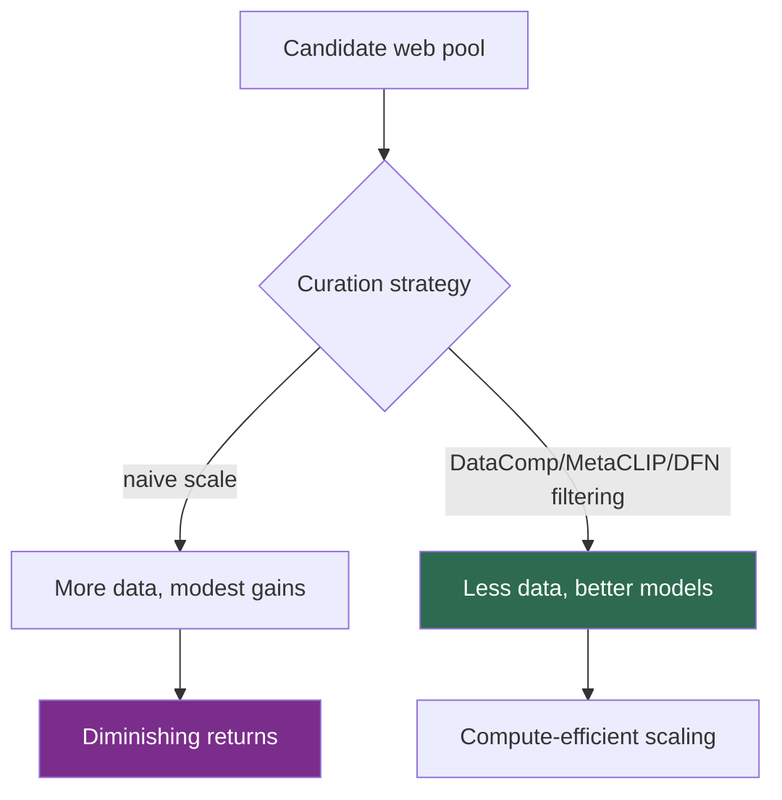

# Scaling Laws in Vision

> **Last Updated:** October 2026
> **Level:** Research Frontier
> **Related Sections:**
> - [Vision Transformers](../03_architectures/01_vision_transformers.md)
> - [Self-Supervised Learning](../03_architectures/03_self_supervised_learning.md)
> - [Multimodal Architectures](../03_architectures/04_multimodal_architectures.md)
> - [Overview: Latest](./00_overview_latest.md)

> **🆕 October 2026 update:**
> - New subsection on **self-supervised scaling without language** (2025): Web-SSL (Web-DINO 0.3B→7B on MC-2B) and DINOv3 (7B ViT, 1.7B curated images, Gram anchoring), which together weaken the "language supervision is required at scale" assumption.
> - New subsection on **2025 contrastive/generative encoder scaling**: SigLIP 2, Perception Encoder, Meta CLIP 2 (worldwide data; breaking the "curse of multilinguality" at ViT-H/14), AIMv2.
> - New subsection on **scaling laws for native multimodal models** (Shukor et al., ICCV 2025 oral): early fusion matches late fusion, and MoE learns modality-specific weights.
> - New notes on video and robot-data scaling (V-JEPA 2/2.1, π₀ 10k+ hours, GR00T N1.7 with 20K hours of human video) and on test-time/RL scaling in VLMs. Key Papers, Benchmark, Open Problems and Further Reading extended.

---

## Overview

Scaling laws—empirical power-law relationships between model performance and the resources of parameters, data, and compute—reshaped language modeling via Kaplan et al. (2020) and the Chinchilla compute-optimal analysis (Hoffmann et al., 2022). The central question for vision is whether these laws transfer: do bigger vision backbones, more data, and more compute yield the same smooth, predictable returns, and is there a compute-optimal parameter/data ratio analogous to Chinchilla's? The 2022–2026 evidence is nuanced: vision models *do* scale, but generally **more slowly and with stronger diminishing returns** than language models, and **data quality dominates raw quantity** to a degree not seen in text.

The canonical demonstrations are ViT-22B [Dehghani2023], which scaled a plain Vision Transformer to 22 billion parameters and showed continued but sublinear gains; the contrastive-vision-language scaling of CLIP/EVA-CLIP/SigLIP; and the data-curation results from DataComp and MetaCLIP showing that *which* image-text pairs you train on can matter more than how many. This file formalizes the scaling relationships, surveys the empirical evidence, and explains why vision's scaling behavior diverges from language's—a divergence with direct consequences for the embodied-AI scaling debate in [Pros, Cons & Roadmaps](../06_robotics_and_embodied_ai/07_pros_cons_roadmaps.md).

The 2025–2026 results add three important refinements. First, **self-supervised vision without any language supervision scales as well as or better than CLIP** once model and data are large enough and the data is curated (Web-SSL [Fan2025], DINOv3 [Simeoni2025]); the bottleneck at scale turned out to be *dense-feature degradation during long training*, which DINOv3 addresses with Gram anchoring. Second, **the objective and the data distribution keep changing the scaling constant**: sigmoid losses, captioning/autoregressive objectives (AIMv2 [Fini2025]), intermediate-layer alignment (Perception Encoder [Bolya2025]) and worldwide multilingual curation (Meta CLIP 2 [Chuang2025]) each buy gains that raw scale does not. Third, **native multimodal models** follow scaling laws close to those of LLMs, with early-fusion architectures matching late-fusion (vision-encoder + LLM) ones [Shukor2025].

---

## The Mathematics of Scaling

A scaling law expresses test loss `L` as a power law in a resource. For a resource `X` (parameters `N`, data `D`, or compute `C`):

```
L(X) ≈ L_inf + (X_0 / X)^alpha
  L_inf : irreducible loss (Bayes error / entropy floor)
  alpha : scaling exponent (larger ⇒ faster returns)
```

Chinchilla's compute-optimal result for language minimizes loss under a compute budget `C ≈ 6·N·D`, yielding `N_opt ∝ C^a`, `D_opt ∝ C^b` with `a ≈ b ≈ 0.5`—i.e., parameters and tokens should grow roughly *equally*. The empirical finding for vision is that the exponents `alpha` tend to be **smaller** (slower returns) and that `L_inf` is reached sooner on saturated benchmarks (ImageNet top-1 plateaus near human-level), so additional scale buys progressively less on classification while still helping transfer and robustness.

For native multimodal models trained from scratch, Shukor et al. [Shukor2025] fit a joint law of the Chinchilla form and report that, as for LLMs, the compute-optimal `N` and `D` grow at similar rates, while early- and late-fusion architectures sit on nearly the same loss–compute frontier:

```
L(N, D) ≈ E + A / N^alpha + B / D^beta
  N : active parameters,  D : multimodal training tokens
  Finding [Shukor2025]: early fusion ≈ late fusion on the compute frontier;
  early fusion is better at small N and cheaper to train/serve;
  sparse MoE improves both by learning modality-specific experts
```

---

## Empirical Evidence in Vision

### Scaling the Backbone: ViT-22B and ViT scaling laws

Zhai et al. (2022), *Scaling Vision Transformers*, mapped ViT performance across model and data scale and characterized a saturating power law; **ViT-22B** [Dehghani2023] then pushed to 22B parameters, improving fairness, robustness, and transfer but with clearly diminishing per-FLOP returns on ImageNet. The lesson: vision benefits from scale most on *transfer and robustness*, less on saturated in-distribution accuracy.

### Contrastive Vision-Language: CLIP, EVA-CLIP, SigLIP

CLIP [Radford2021] established that contrastive image-text pretraining scales with data and model size for zero-shot transfer. **EVA-CLIP** scaled masked-image-modeling-initialized CLIP efficiently to billions of parameters; **SigLIP** [Zhai2023] replaced the softmax contrastive loss with a **sigmoid loss** that decouples batch size from the loss normalization, improving scaling efficiency at small and large batch sizes alike. These show that *objective design* materially changes the scaling constant.

### Data Quality over Quantity: DataComp, MetaCLIP, DFN

The strongest vision-specific finding is that **data curation rivals or beats scale**. **DataComp** (Gadre et al., 2023) framed dataset design as the experimental variable and showed that aggressive filtering of a fixed candidate pool yields better models than naively using more data. **MetaCLIP** reverse-engineered CLIP's curation to make it reproducible, and **DFN (Data Filtering Networks)** trained a network to select high-quality pairs, producing DFN-2B/5B that outperform much larger uncurated sets. This is the vision analogue of the "quality tokens" lesson in language, but more pronounced because web image-text alignment is noisier than text.



### Self-Supervised Scaling without Language (2025): Web-SSL and DINOv3

A long-standing belief was that language supervision (CLIP) is what lets vision encoders scale and serve MLLMs. **Web-SSL** [Fan2025] (*Scaling Language-Free Visual Representation Learning*, FAIR/NYU/Princeton) tested this by training Web-DINO models from 0.3B to 7B parameters and Web-MAE models up to 3B on the same web data (MC-2B) used for CLIP baselines. Performance improved steadily with model size and data; at scale, vision-only models matched or surpassed language-supervised encoders on a broad VQA suite—including OCR and chart understanding, which CLIP previously dominated—once the data was filtered toward text-rich images. The implication: CLIP's apparent scaling advantage was largely a *data distribution* advantage, not a *supervision* advantage.

**DINOv3** [Simeoni2025] (Meta, Aug 2025) scaled DINO-style SSL to a **7B-parameter ViT (6.7B)** trained on **LVD-1689M**, a curated set of ~1.7B web images (vs. ~142M for DINOv2), plus a satellite variant trained on SAT-493M. The key scaling obstacle was that dense (patch-level) feature quality *degrades* during long schedules of large models even as global metrics improve; DINOv3 introduces **Gram anchoring**, a regularizer that keeps the Gram matrix of patch features close to that of an earlier checkpoint, restoring dense-feature quality. The 7B teacher is then distilled into ViT-S/B/L/H+ (21M–840M) and ConvNeXt (29M–198M) students—an increasingly standard "train one giant, ship many small" recipe that decouples scaling (done once) from deployment cost.

### Encoder Objectives Revisited (2025): SigLIP 2, Perception Encoder, Meta CLIP 2, AIMv2

- **SigLIP 2** [Zhai2025] combines the sigmoid loss with captioning-based pretraining, self-distillation and masked prediction, improving dense features and multilingual coverage at each model size.
- **Perception Encoder (PE)** [Bolya2025] scales a single contrastive image/video encoder (PE-Core-G14-448: 85.4% ImageNet zero-shot) and shows that the best features for dense prediction and for MLLMs lie in *intermediate* layers; lightweight alignment ("PE-lang", "PE-spatial") surfaces them. This suggests scaling studies that measure only the final embedding underestimate what large encoders learn.
- **Meta CLIP 2** [Chuang2025] (NeurIPS 2025 spotlight) is the first recipe training CLIP from scratch on *worldwide* web data. Multilingual CLIPs typically suffer a "curse of multilinguality" (English accuracy below English-only training); Meta CLIP 2 scales seen pairs in proportion to the added non-English data and finds that ViT-H/14 is the capacity inflection point where worldwide data yields mutual benefit (+0.8% ImageNet zero-shot over the English-only counterpart, SOTA on CVQA at 57.4%). Capacity thus becomes a *precondition* for benefitting from data diversity.
- **AIMv2** [Fini2025] (CVPR 2025 highlight) pretrains vision encoders with a multimodal autoregressive objective (decoder reconstructs image patches and caption tokens). Frozen-trunk ImageNet accuracy rises monotonically from 86.6% (0.3B, 224px) to 88.5% (2.7B, 224px) and 89.5% (2.7B, 448px), outperforming CLIP and SigLIP on most multimodal understanding benchmarks.

### Scaling Laws for Native Multimodal Models (2025)

Shukor et al. [Shukor2025] (Apple/Sorbonne; ICCV 2025 oral) ran hundreds of training runs of *native* multimodal models trained from scratch on image-caption, interleaved and text data. They find no inherent advantage for late fusion (separate pretrained vision encoder + LLM) over early fusion (raw patches fed directly to one transformer); early fusion is stronger at lower parameter counts, cheaper to train and simpler to deploy, and sparse **Mixture-of-Experts** substantially helps by learning modality-specific weights. Production systems moved in this direction in 2025–2026: Qwen3.5 (Feb 2026) describes "early fusion training on trillions of multimodal tokens", and Emu3.5 / BAGEL train unified understanding-and-generation models on interleaved video-text data (see [Multimodal LLMs 2025–2026](./03_multimodal_llm_2025_2026.md)).

### Video, World-Model and Robot-Data Scaling

- **Video SSL.** V-JEPA 2 scaled latent-prediction pretraining to >1M hours of video and a 1B-parameter ViT-g, with action-conditioned post-training on <100 hours of robot data; V-JEPA 2.1 (Mar 2026) extends the family to 2B parameters (ViT-G/16) with a recipe focused on temporally consistent dense features.
- **Robot data.** Robot-policy scaling is limited by data collection, not compute. π₀ was pre-trained on 10k+ hours of robot data; NVIDIA's GR00T N1.7 (2026) augments robot data with **20K hours of egocentric human video** (EgoScale), and NitroGen (CVPR 2026 HM) mines internet gameplay video for action labels—examples of substituting abundant *human/agent video* for scarce robot teleoperation (see [VLA & Embodied 2025–2026](./04_vla_embodied_2025_2026.md)).
- **World models.** NVIDIA's Cosmos 3 (May 2026) is released at 4B/16B/64B, with the largest model positioned as a distillation teacher—again "scale once, distill to deploy".

### Test-Time and RL Scaling in VLMs

Language-model "thinking" carried over to vision in 2025. InternVL3.5's **Cascade RL** (offline RL for stable convergence followed by online RL) yields substantial gains on reasoning benchmarks such as MMMU and MathVista, and most frontier MLLMs (GPT-5, Gemini 3, Qwen3-VL "Thinking" variants, GLM-4.5V) expose a reasoning mode. This introduces a *third* scaling axis—inference compute—whose returns on perception-heavy tasks (counting, grounding, OCR) are much smaller than on math/diagram reasoning.

---

## Key Papers

| Paper | Authors | Year | Venue | Key Contribution |
|-------|---------|------|-------|-----------------|
| Scaling Vision Transformers | Zhai, Kolesnikov, Houlsby, Beyer | 2022 | CVPR | Empirical saturating scaling law for ViTs |
| ViT-22B | Dehghani, Djolonga, Mustafa, et al. | 2023 | ICML | 22B-param ViT; gains in robustness/transfer, sublinear |
| SigLIP (Sigmoid loss) | Zhai, Mustafa, Kolesnikov, Beyer | 2023 | ICCV | Sigmoid contrastive loss for efficient scaling |
| DataComp | Gadre, Ilharco, Fang, et al. | 2023 | NeurIPS | Dataset design as the scaling variable; curation > scale |
| Data Filtering Networks (DFN) | Fang, Jose, Jain, et al. | 2023 | arXiv→ICLR | Learned data filtering yields DFN-2B/5B |
| Multimodal Autoregressive Pre-training of Large Vision Encoders (AIMv2) | Fini, Shukor, Li, et al. | 2025 | CVPR (Highlight) | Autoregressive image+text objective; monotonic gains to 2.7B; 89.5% frozen-trunk ImageNet |
| SigLIP 2 | Tschannen, Gritsenko, Wang, et al. | 2025 | arXiv 2502.14786 | Sigmoid loss + captioning + self-distillation; multilingual, better dense features |
| Scaling Language-Free Visual Representation Learning (Web-SSL) | Fan, Tong, Zhu, et al. | 2025 | arXiv 2504.01017 | Vision-only SSL (0.3B–7B) matches/surpasses CLIP on VQA at scale |
| Scaling Laws for Native Multimodal Models | Shukor, Fini, Turrisi da Costa, Cord, Susskind, El-Nouby | 2025 | ICCV (Oral) | Early fusion ≈ late fusion on compute frontier; MoE helps |
| Perception Encoder | Bolya, Huang, Sun, et al. | 2025 | arXiv 2504.13181 | Best embeddings lie in intermediate layers; PE-Core-G 85.4% IN zero-shot |
| Meta CLIP 2: A Worldwide Scaling Recipe | Chuang, Li, Wang, et al. | 2025 | NeurIPS (Spotlight) | Worldwide curation; capacity threshold (ViT-H/14) breaks curse of multilinguality |
| DINOv3 | Siméoni, Vo, Seitzer, et al. | 2025 | arXiv 2508.10104 | 7B SSL ViT on 1.7B images; Gram anchoring; distilled family |

---

## Benchmark Performance

| Model | Params | Setting | Result | Notes |
|-------|--------|---------|--------|-------|
| ViT-22B | 22B | ImageNet transfer | SOTA robustness/fairness | Sublinear per-FLOP gains [Dehghani2023] |
| SigLIP | ~400M–1B | Zero-shot ImageNet | Strong, batch-efficient | Sigmoid loss [Zhai2023] |
| DFN-5B-CLIP | ViT-scale | Zero-shot ImageNet | Beats larger uncurated sets | Learned filtering |
| CLIP ViT-L/14 | ~300M | Zero-shot ImageNet | 75–76% top-1 | Baseline contrastive scaling |
| MetaCLIP ViT-bigG-14 v1.1 | bigG/14 | Zero-shot ImageNet | 82.1% | 2.5B curated pairs |
| Meta CLIP 2 ViT-bigG-14 (378px) | bigG/14 | CVQA-LOCAL (multilingual) | 62.0% | Worldwide data, 29B seen pairs |
| PE-Core-G14-448 | G/14 | Zero-shot ImageNet | 85.4% | ImageNet-A 92.6% [Bolya2025] |
| AIMv2-3B (448px) | 2.7B | ImageNet frozen trunk | 89.5% | 86.6% at 0.3B/224px → monotonic scaling |
| DINOv3 ViT-7B | 6.7B | Dense tasks (seg., depth, tracking) | SOTA among SSL/weakly-supervised encoders (per authors) | Distilled ViT-L reaches near-parity on many tasks |
| V-JEPA 2 ViT-g | 1B | SSv2 attentive probe | 77.3% | 1M+ hours of video |

---

## Pros & Cons

| Aspect | Pros | Cons |
|--------|------|------|
| Scaling backbones | Predictable gains in transfer/robustness | Strong diminishing returns on saturated benchmarks |
| Contrastive scaling (CLIP/SigLIP) | Zero-shot transfer scales with data | Sensitive to objective and batch design |
| Data curation (DataComp/DFN) | Compute-efficient; quality beats quantity | Curation pipelines complex; risk of distribution narrowing |
| Chinchilla-style compute-optimality | Principled budget allocation | Vision exponents differ; recipe not directly portable |
| Language-free SSL at scale (Web-SSL, DINOv3) | No captions needed; superior dense features; scales to 7B | Very large curated pools and long schedules; dense-feature degradation needs extra regularization (Gram anchoring) |
| Giant-teacher distillation | One expensive run serves many deployment sizes | Students inherit teacher biases; scaling claims hard to reproduce without the teacher |
| Native early-fusion multimodal scaling | Simpler, cheaper at small N; MoE specializes per modality | Needs trillions of multimodal tokens; ablations mostly from a few industrial labs |

---

## Open Problems & Research Gaps

- **A vision Chinchilla.** No agreed compute-optimal `N`/`D` law for vision backbones exists; exponents vary by objective and benchmark. Shukor et al. provide one for *native multimodal* models, but not for pure vision encoders evaluated on dense tasks.
- **Benchmark saturation.** ImageNet top-1 is near `L_inf`; scaling research lacks unsaturated, transfer-relevant metrics.
- **Quality vs. quantity formalization.** DataComp/DFN are empirical; a predictive theory of data quality's effect on the scaling constant is missing.
- **Self-supervised scaling.** Whether MIM/contrastive SSL (see [Self-Supervised Learning](../03_architectures/03_self_supervised_learning.md)) scales like supervised/contrastive-VL is under-characterized—DINOv2 suggests curation again dominates. Web-SSL and DINOv3 now show SSL *can* scale to 7B, but the role of curation (LVD-1689M, text-rich filtering) is still entangled with the objective.
- **Dense-feature scaling.** Global metrics and dense metrics can move in opposite directions during long training (the problem Gram anchoring patches); a scaling theory for *patch-level* representations is missing.
- **Multimodal joint scaling.** Optimal allocation across vision encoder, connector, and LLM in VLMs (see [Large Vision-Language Models](../05_multimodal_vision_language/02_large_vision_language_models.md)) is unsolved; early-fusion results suggest the encoder may not need to be separate at all.
- **Capacity thresholds.** Meta CLIP 2 shows data diversity only helps above a model-size threshold; predicting such thresholds in advance is open.
- **Embodied scaling laws.** Whether robot policies follow analogous laws is actively debated (see [Pros, Cons & Roadmaps](../06_robotics_and_embodied_ai/07_pros_cons_roadmaps.md)); the exchange rate between hours of human video and hours of robot teleoperation is unknown.
- **Energy/efficiency frontiers.** Scaling laws ignore the rising marginal energy cost that increasingly bounds practical scale.

---

## Further Reading

- [Scaling Vision Transformers (arXiv:2106.04560)](https://arxiv.org/abs/2106.04560) — ViT scaling behavior
- [ViT-22B (arXiv:2302.05442)](https://arxiv.org/abs/2302.05442) — scaling ViTs to 22B parameters
- [SigLIP (arXiv:2303.15343)](https://arxiv.org/abs/2303.15343) — sigmoid loss for language-image pretraining
- [DataComp (arXiv:2304.14108)](https://arxiv.org/abs/2304.14108) — dataset design as the scaling variable
- [Chinchilla (arXiv:2203.15556)](https://arxiv.org/abs/2203.15556) — compute-optimal scaling (language reference)
- [Web-SSL: Scaling Language-Free Visual Representation Learning (arXiv:2504.01017)](https://arxiv.org/abs/2504.01017) — vision-only SSL at 7B
- [DINOv3 (arXiv:2508.10104)](https://arxiv.org/abs/2508.10104) — 7B SSL with Gram anchoring
- [Scaling Laws for Native Multimodal Models (arXiv:2504.07951)](https://arxiv.org/abs/2504.07951) — early vs. late fusion
- [Perception Encoder (arXiv:2504.13181)](https://arxiv.org/abs/2504.13181) — intermediate-layer features
- [Meta CLIP 2 (arXiv:2507.22062)](https://arxiv.org/abs/2507.22062) — worldwide CLIP scaling
- [AIMv2 (arXiv:2411.14402)](https://arxiv.org/abs/2411.14402) — multimodal autoregressive encoder pretraining
- [SigLIP 2 (arXiv:2502.14786)](https://arxiv.org/abs/2502.14786) — multilingual, dense-feature SigLIP
