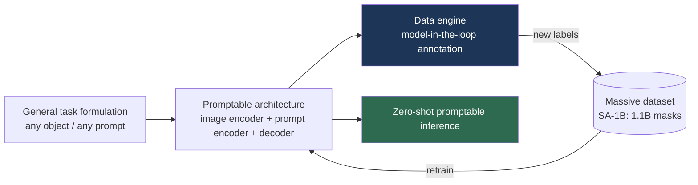
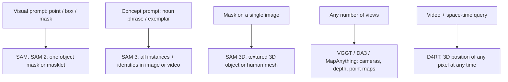

# The "Anything" Model Paradigm

> **Last Updated:** October 2026
> **Level:** Research Frontier
> **Related Sections:**
> - [Semantic Segmentation](../02_core_tasks/02_semantic_segmentation.md)
> - [Depth Estimation](../02_core_tasks/05_depth_estimation.md)
> - [Open-Vocabulary Detection](../05_multimodal_vision_language/03_open_vocabulary_detection.md)
> - [Overview: Latest](./00_overview_latest.md)

> **🆕 October 2026 update:**
> - **SAM 3** (Nov 2025, ICLR 2026): from visual prompts to *concept* prompts—detect, segment and track every instance of a noun phrase or exemplar; SA-Co benchmark (270K concepts); **SAM 3.1** Object Multiplex (Mar 2026).
> - **SAM 3D Objects / SAM 3D Body** (Nov 2025; CVPR 2026 Best Paper Honorable Mention) and **Depth Anything 3** (Nov 2025) extend the recipe to single-image 3D and any-view geometry.
> - New subsection on **feed-forward geometry "anything" models**: VGGT (CVPR 2025 Best Paper), MapAnything, D4RT (CVPR 2026 Best Paper).
> - Recipe now spreads beyond vision (SAM Audio) and into unified world models (Cosmos 3); Key Papers, Benchmarks and Open Problems updated.

---

## Overview

The "Segment Anything"-style paradigm is the most consequential structural shift in computer vision of 2023–2024: the replacement of narrow, dataset-specific models with **single foundation models that solve a task universally via promptable inference**. The template, established by SAM [Kirillov2023], has three reproducible ingredients: (1) a **task formulation general enough to span a whole problem class** (any object, any prompt, any image); (2) a **data engine** that bootstraps a massive labeled dataset by iterating model-in-the-loop annotation; and (3) a **promptable architecture** that performs zero-shot inference on new inputs without retraining. The same recipe was rapidly transplanted to depth (Depth Anything), recognition (Recognize Anything), and tracking (Track Anything), producing a family of "X-Anything" models that now serve as off-the-shelf perceptual primitives—including for robotics, where they supply scene representations (see [Perception for Robotics](../06_robotics_and_embodied_ai/08_perception_for_robotics.md)).

What makes a model genuinely "universal" rather than merely large is the combination of **task generality** and **prompt-based zero-shot transfer**. SAM does not classify; it segments *whatever it is pointed at*, decoupling the geometric task (find the mask) from the semantic task (name it). This separation is the paradigm's conceptual core and the reason these models compose so well with open-vocabulary semantics (Grounded-SAM = Grounding DINO + SAM). This file dissects the recipe, surveys the major instances, and examines the limits of universality.

In 2025–2026 the paradigm entered a second phase along three axes. **Semantic**: SAM 3 [Carion2025] closes much of the "segments but doesn't name" gap by accepting *concept* prompts and returning all matching instances with identities across video. **Geometric**: the "anything" ambition moved from 2D masks to 3D and 4D—single-image object and human reconstruction (SAM 3D), any-view depth and pose (Depth Anything 3 [Lin2025], VGGT [Wang2025], MapAnything [Keetha2025]) and dynamic-scene reconstruction (D4RT [Zhang2025]). **Modal**: the recipe is now applied to audio (SAM Audio) and folded into unified world models (NVIDIA Cosmos 3) that both perceive and generate.

---

## The Recipe

The 2025–2026 generation keeps the three ingredients but changes what is prompted and what is predicted:

### Segment Anything (SAM, SAM2)

**SAM** [Kirillov2023] (ICCV 2023, Meta) consists of a heavy ViT image encoder, a lightweight prompt encoder (points, boxes, masks), and a fast mask decoder, trained on **SA-1B: 1.1 billion masks over 11 million images**, built by a three-stage data engine (assisted-manual → semi-automatic → fully automatic). It performs **zero-shot promptable segmentation** on unseen distributions. **SAM 2** [Ravi2024] (Meta, 2024) extends this to **video** with a streaming memory module enabling promptable segmentation and tracking across frames in real time, trained with the SA-V data engine on a far larger and more diverse video corpus (see [Semantic Segmentation](../02_core_tasks/02_semantic_segmentation.md)).

### SAM 3: Promptable Concept Segmentation (2025–2026)

**SAM 3** [Carion2025] (Meta, Nov 2025; ICLR 2026) defines **Promptable Concept Segmentation (PCS)**: given a short noun phrase ("yellow school bus"), image exemplars, or both, return masks and persistent identities for *every* matching instance in an image or video. Architecturally, an image-level DETR-style detector and a SAM 2-style memory-based tracker share one Perception Encoder (PE) vision backbone (848M parameters in total); a **presence head** predicts whether the concept is present at all, decoupling recognition ("is it here?") from localization ("where is each one?") and reducing false positives on hard negatives. The data engine—combining human annotators, SAM 3 itself and MLLM-based verifiers—produced over **4 million unique concept labels**, and the released **SA-Co** benchmark covers **270K unique concepts**, over 50× more than prior open-vocabulary segmentation benchmarks. SAM 3 reaches roughly 75–80% of human performance on SA-Co (cgF1 55.7 vs. 74.0 on SA-Co/Gold) and the authors report roughly doubling prior systems on image and video concept segmentation. For long, compositional queries, a "SAM 3 Agent" pairs an MLLM (which decomposes the query) with SAM 3 (which grounds noun phrases). **SAM 3.1 Object Multiplex** (Mar 2026) introduced a shared-memory approach for joint multi-object tracking, which the authors describe as significantly faster without sacrificing accuracy.

### SAM 3D: Objects and Bodies (2025)

**SAM 3D Objects** (arXiv 2511.16624) reconstructs full 3D shape, texture and layout (pose in the scene) of a masked object from a single natural image—explicitly targeting occlusion and clutter rather than clean, centered product shots—and exports Gaussian splats or meshes. Its recipe mirrors SAM's: progressive training with a **human-in-the-loop data engine** in which annotators rank and refine model-proposed 3D shapes, sidestepping the lack of real-image 3D ground truth. **SAM 3D Body** (arXiv 2602.15989) is a promptable (2D keypoints, masks) model for single-image full-body human mesh recovery using the Momentum Human Rig (MHR) parametric model, with DINOv3-H+ or ViT-H backbones. SAM 3D received a **CVPR 2026 Best Paper Honorable Mention**.

### Depth Anything

**Depth Anything** [Yang2024a] (CVPR 2024) and **Depth Anything V2** [Yang2024b] apply the recipe to **monocular depth estimation**, scaling to ~62M+ images by leveraging large-scale *unlabeled* data with pseudo-labels from a teacher, plus semantic priors. V2 trains on synthetic labeled + pseudo-labeled real data to produce sharp, robust relative depth that is now a default perceptual primitive—including for the spatial-data pipelines of [Spatial Intelligence](./06_spatial_intelligence.md) (see [Depth Estimation](../02_core_tasks/05_depth_estimation.md)).

**Depth Anything 3** [Lin2025] (ByteDance Seed, Nov 2025) generalizes from one image to **any number of views, with or without known poses**. Two deliberately minimal choices define it: a single plain transformer (a vanilla DINO encoder) as backbone with no 3D-specific architecture, and a single **depth-ray** prediction target (per-pixel depth plus ray origin/direction) from which cameras and point clouds are derived, avoiding multi-task losses. Trained only on public academic datasets, DA3 is reported to outperform DA2 on monocular depth and VGGT on multi-view depth and pose; variants range from 0.08B to 1.40B parameters, with metric and streaming (DA3-Streaming, <12 GB GPU memory for very long videos) versions.

### Feed-Forward Geometry "Anything" Models (2025–2026)

A parallel line replaced classical SfM/MVS and per-scene optimization with a single network that accepts *arbitrary* view counts and inputs:

- **VGGT** [Wang2025] (Oxford VGG + Meta; **CVPR 2025 Best Paper**): a 1B-parameter transformer that predicts camera intrinsics/extrinsics, depth maps, point maps and 3D point tracks from one to hundreds of views in seconds. Released VGGT-Omega in May 2026.
- **MapAnything** [Keetha2025] (Meta/CMU; 3DV 2026): one transformer for *metric* 3D reconstruction that optionally ingests intrinsics, depth or poses alongside images and supports 12+ tasks (SfM, MVS, monocular metric depth, registration, depth completion) in one model; released with Apache-2.0 and non-commercial checkpoints.
- **D4RT** [Zhang2025] (Google DeepMind, UCL, Oxford; **CVPR 2026 Best Paper**): encodes a video once into a global scene representation; a lightweight decoder answers independent queries "where is pixel *p* from frame *t* in 3D at time *t′*, seen from camera *c*?". Depth, point tracking, and camera pose all become special cases of the same query, and parallel queries yield up to 300× faster inference than prior dynamic-reconstruction methods, according to the authors. This is the "promptable" idea transplanted to 4D: the prompt is a space-time query rather than a click.

### Recognize / Track / Grounded Anything

**Recognize Anything (RAM, RAM++)** [Zhang2023] provides strong open-set image tagging. **Track Anything** couples SAM with video trackers for interactive video object segmentation. **Grounded-SAM** composes **Grounding DINO** (open-vocabulary detection, see [Open-Vocabulary Detection](../05_multimodal_vision_language/03_open_vocabulary_detection.md)) with SAM to achieve text-prompted "detect-and-segment anything," exemplifying the paradigm's compositionality. SAM 3 now subsumes much of the Grounded-SAM pipeline in a single model, although composition with MLLMs remains necessary for reasoning-heavy queries.

### Beyond Vision and Toward Unified Models

**SAM Audio** (Meta, Dec 2025; arXiv 2512.18099) applies the promptable recipe to sound separation: isolate any sound from a mixture using text, visual (a masked object in video) or temporal-span prompts. In the other direction, the "anything" encoders are being absorbed into larger unified models: **NVIDIA Cosmos 3** (May 2026) exposes a *Reasoner* (text+vision→text) and a *Generator* (text, vision, sound, action → vision, sound, action) on one architecture, and DINOv3 [Simeoni2025] has become the default frozen backbone for many of the above systems (e.g., SAM 3D Body's DINOv3-H+ variant).

---

## Key Papers

| Paper | Authors | Year | Venue | Key Contribution |
|-------|---------|------|-------|-----------------|
| Segment Anything (SAM) | Kirillov, Mintun, Ravi, et al. | 2023 | ICCV | Promptable segmentation + SA-1B (1.1B masks) data engine |
| SAM 2 | Ravi, Gabeur, Hu, et al. | 2024 | Meta / arXiv | Promptable segmentation & tracking in video w/ memory |
| Depth Anything | Yang, Kang, Huang, et al. | 2024 | CVPR | Monocular depth foundation via large unlabeled data |
| Depth Anything V2 | Yang, Kang, Huang, et al. | 2024 | NeurIPS | Sharper, robust depth via synthetic + pseudo-labels |
| Recognize Anything (RAM) | Zhang, Huang, Ma, et al. | 2023 | arXiv→CVPRW | Strong open-set image tagging foundation model |
| VGGT: Visual Geometry Grounded Transformer | Wang, Chen, Karaev, Vedaldi, Rupprecht, Novotny | 2025 | CVPR (Best Paper) | Feed-forward cameras, depth, point maps and tracks from 1–hundreds of views |
| MapAnything: Universal Feed-Forward Metric 3D Reconstruction | Keetha et al. | 2025 | 3DV 2026 | One model for 12+ metric 3D tasks with optional geometric inputs |
| SAM 3: Segment Anything with Concepts | Carion et al. | 2025 | ICLR 2026 | Promptable concept segmentation; presence head; SA-Co (270K concepts) |
| SAM 3D Objects | Meta (SAM 3D Team) | 2025 | arXiv 2511.16624; CVPR 2026 HM | Single-image 3D object shape, texture and layout in cluttered scenes |
| SAM 3D Body | Meta (SAM 3D Team) | 2026 | arXiv 2602.15989 | Promptable single-image full-body human mesh recovery (MHR) |
| Depth Anything 3: Recovering the Visual Space from Any Views | Lin, Chen, Liew, et al. | 2025 | arXiv 2511.10647 | Plain-transformer depth-ray prediction for any-view depth and pose |
| Efficiently Reconstructing Dynamic Scenes One D4RT at a Time | Zhang, Le Moing, Koppula, et al. | 2025 | CVPR 2026 (Best Paper) | Query-based unified 4D reconstruction; up to 300× faster |
| SAM Audio | Meta | 2025 | arXiv 2512.18099 | Text/visual/span-prompted sound separation |

---

## Benchmark Performance

| Model | Task | Dataset/Metric | Result | Notes |
|-------|------|----------------|--------|-------|
| SAM | Zero-shot seg | 23 datasets | Strong zero-shot mIoU/AR | Promptable, no fine-tuning [Kirillov2023] |
| SAM 2 | Video seg | SA-V / J&F | SOTA interactive VOS, real-time | Streaming memory [Ravi2024] |
| Depth Anything V2 | Mono depth | Zero-shot rel. depth | Robust, sharp edges | 62M+ images incl. unlabeled |
| Grounded-SAM | Text→mask | Open-vocab seg | Compositional zero-shot | Grounding DINO + SAM |
| SAM 3 | Concept seg (image) | SA-Co/Gold / cgF1 | 55.7 (human 74.0) | ~75–80% of human performance [Carion2025] |
| SAM 3 | Concept seg (video) | SA-V test / cgF1; YT-Temporal-1B / pHOTA | 30.3; 63.6 | Humans 53.1 and 78.4 |
| SAM 3 | Video instance seg | LVVIS test / mAP; BURST test / HOTA | 36.3; 44.5 | Single model, concept-prompted |
| SAM 3D Body (DINOv3-H+) | Human mesh recovery | 3DPW / MPJPE; FreiHAND / PA-MPJPE | 54.8; 5.5 | vs. CameraHMR, NLF, HMR2.0b (qualitative claims of improvement) |
| Depth Anything 3 (Nested-Giant-Large) | Pose (ray head) | ScanNet++ / AUC3; HiRoom / AUC3 | 89.4; 84.4 | Ray head beats camera head on 4/5 datasets |
| VGGT-1B-Commercial | Camera pose | Co3D / AUC@30 | 90.37 | Original checkpoint 89.98 |
| D4RT | Dynamic 4D reconstruction | Dynamic-scene benchmarks | SOTA (per authors); up to 300× faster | Weights not publicly released at time of writing |

---

## Pros & Cons

| Aspect | Pros | Cons |
|--------|------|------|
| Promptable universality | Zero-shot on new distributions; no per-task training | Geometric task only—SAM segments but doesn't name (partly addressed by SAM 3 concept prompts) |
| Data engine | Bootstraps billion-scale labels cheaply | Pseudo-label noise; teacher bias propagation |
| Compositionality | Plugs into open-vocab/LLM pipelines | Error compounding across composed modules |
| Off-the-shelf primitive | Reusable across robotics/AV/medical | Heavy encoders; latency for real-time/edge use |
| Concept prompts (SAM 3) | Exhaustive instance recall with identities; open-vocabulary detection, segmentation and tracking in one model | Short noun phrases only; complex referring expressions need an MLLM agent; ~20–25% gap to humans on SA-Co |
| Feed-forward 3D/4D (VGGT, DA3, MapAnything, D4RT) | Seconds instead of hours; unified outputs (pose, depth, tracks); strong priors for robotics/AR | Metric scale, very long sequences and unusual optics remain hard; licensing varies (commercial vs. non-commercial checkpoints; some weights unreleased) |
| Human-in-the-loop 3D data engines (SAM 3D) | Scales 3D supervision on real images where ground truth is unavailable | Preference-based labels encode annotator aesthetics; physical accuracy of hidden geometry is unverifiable |

---

## Open Problems & Research Gaps

- **Semantic universality.** SAM is geometrically universal but semantically blank; truly universal *recognition* (open-world naming at SAM's coverage) is unsolved. SAM 3's concept prompts and SA-Co (270K concepts) are a large step, but long-tail, fine-grained and compositional concepts still lag human performance.
- **Efficiency.** The ViT encoders are heavy; distilling "Anything" models to edge/real-time budgets (MobileSAM, EfficientSAM) trades accuracy for speed. Distilled DINOv3 students and SAM 3.1's multiplexed tracking are recent efficiency moves.
- **3D and 4D "Anything."** Extending the recipe to promptable 3D/4D scene understanding (cf. [4D & Dynamic Scenes](./05_4d_and_dynamic_scenes.md)) progressed quickly in 2025–2026 (SAM 3D, DA3, VGGT, MapAnything, D4RT), but these models still reconstruct geometry rather than *semantically* segmenting and reasoning about 3D/4D scenes; a "SAM 3 in 4D" with concept prompts remains open.
- **Data-engine bias.** Automatic annotation inherits and amplifies teacher-model biases and failure modes.
- **Metric grounding.** Depth Anything yields *relative* depth; universal *metric* depth remains harder. MapAnything and DA3-Metric close part of the gap, but scale ambiguity persists without auxiliary inputs.
- **Evaluation of universality.** No agreed protocol measures how "universal" a model truly is versus benchmark-distribution overfitting.
- **Composability guarantees.** Pipelines like Grounded-SAM lack error bounds when modules are chained.
- **Unification vs. specialization.** It is unclear whether separate "anything" models (segmentation, depth, 3D, audio) will persist as tools called by MLLM agents, or be absorbed into unified perceive-and-generate world models (Cosmos 3-style).

---

## Further Reading

- [Segment Anything (arXiv:2304.02643)](https://arxiv.org/abs/2304.02643) — the founding paper and SA-1B
- [SAM 2 (arXiv:2408.00714)](https://arxiv.org/abs/2408.00714) — segment anything in images and video
- [Depth Anything V2 (arXiv:2406.09414)](https://arxiv.org/abs/2406.09414) — robust monocular depth foundation
- [Grounded-SAM (arXiv:2401.14159)](https://arxiv.org/abs/2401.14159) — open-vocabulary detect-and-segment
- [Recognize Anything (arXiv:2306.03514)](https://arxiv.org/abs/2306.03514) — open-set tagging
- [SAM 3 (arXiv:2511.16719)](https://arxiv.org/abs/2511.16719) and [code incl. SAM 3.1](https://github.com/facebookresearch/sam3) — concept segmentation
- [SAM 3D Objects](https://github.com/facebookresearch/sam-3d-objects) and [SAM 3D Body](https://github.com/facebookresearch/sam-3d-body) — single-image 3D
- [Depth Anything 3 (arXiv:2511.10647)](https://arxiv.org/abs/2511.10647) — any-view depth and pose
- [VGGT (arXiv:2503.11651)](https://arxiv.org/abs/2503.11651) — CVPR 2025 Best Paper
- [MapAnything (arXiv:2509.13414)](https://arxiv.org/abs/2509.13414) — universal metric 3D reconstruction
- [D4RT (arXiv:2512.08924)](https://arxiv.org/abs/2512.08924) — CVPR 2026 Best Paper
- [SAM Audio (arXiv:2512.18099)](https://arxiv.org/abs/2512.18099) — promptable audio separation
