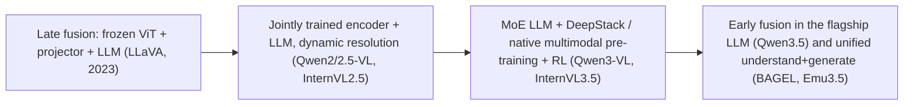
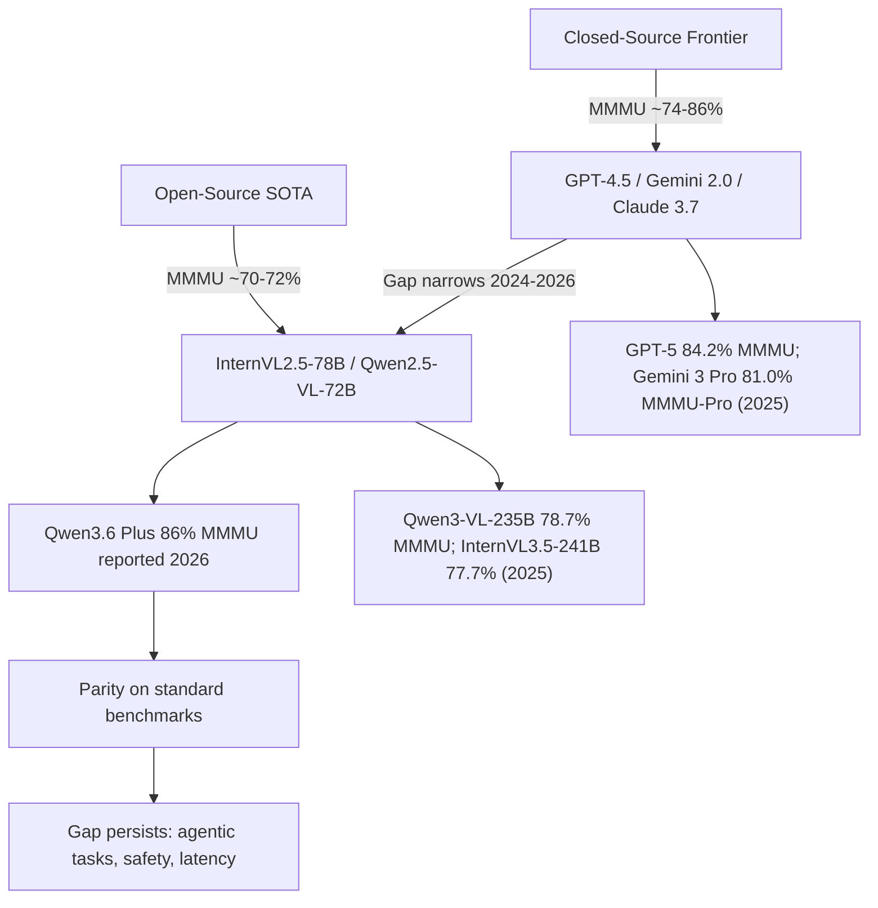

# Multimodal LLMs: State of the Art 2025–2026

> **Last Updated:** October 2026
> **Level:** Research Frontier
> **Related Sections:**
> - [Large Vision-Language Models](../05_multimodal_vision_language/02_large_vision_language_models.md)
> - [VLA & Embodied AI Frontier](./04_vla_embodied_2025_2026.md)
> - [Future Trends](./07_future_trends.md)

> **🆕 October 2026 update:**
> - Added the 2025–2026 frontier: **GPT-5** (MMMU 84.2%), **Gemini 3 Pro** (MMMU-Pro 81.0%, Video-MMMU 87.6%, ScreenSpot-Pro 72.7%), and the shift of evaluation from MMMU to MMMU-Pro / Video-MMMU / GUI grounding.
> - New open-model profiles: **Qwen3-VL** (2B–235B-A22B, Interleaved-MRoPE, DeepStack, 256K→1M context), **InternVL3 / InternVL3.5** (Cascade RL, up to 241B-A28B), **Qwen3.5 / Qwen3.6** (early-fusion multimodal pre-training), GLM-4.5V/4.6V, MiniCPM-V 4.5–4.7, PerceptionLM.
> - New architecture family: **early-fusion and unified understanding+generation models** (Qwen3.5, BAGEL, Emu3.5), plus RL/"thinking" post-training.
> - Corrected the open-problem claim that no open model offers 1M-token multimodal context (Qwen3-VL supports 256K native, expandable to 1M); qualified unverified third-party scores.

---

## Overview

The period from 2024 to 2026 has witnessed a decisive maturation of multimodal large language models (MLLMs), transitioning from add-on vision adapters bolted onto frozen language models toward natively multimodal architectures trained end-to-end across text, image, audio, and video. The competitive frontier is now defined by four axes: (1) perceptual breadth — how many modalities and resolutions a single model handles natively; (2) context length — from 32 K tokens to 1 M+ tokens unlocking hour-long video understanding; (3) reasoning depth — mathematical and scientific problem-solving over visual evidence; and (4) the open/closed gap — the degree to which the open-source community can reproduce closed-model performance.

Closed-source models led strongly through 2024. GPT-4o (May 2024) established a new reference point by unifying text, vision, and audio into a single end-to-end omni-modal decoder, achieving 69.1% on MMMU and significantly outpacing its predecessor GPT-4V. Google's Gemini 1.5 Pro broke ground with a sparse mixture-of-experts architecture that supports up to 1 M tokens of mixed-modality context — enough to ingest and reason over full feature-length films. By early 2025 Gemini 2.0 Flash extended that lineage with 70.7% on MMMU at lower inference cost, while Anthropic's Claude 3.5/3.7 Sonnet vision variants pushed document understanding close to 96% on DocVQA.

The open-source landscape underwent a parallel revolution. InternVL2.5-78B became the first open model to surpass 70% on MMMU (70.1% with chain-of-thought), and Qwen2.5-VL-72B matched or exceeded many closed baselines across MathVista (74.8), MMBench (88.6), and DocVQA (96.4). By mid-2026, the functional gap between leading open and closed models on standard benchmarks has narrowed substantially, though closed models retain advantages on agentic, long-horizon, and safety-sensitive tasks.

From mid-2025 the frontier moved again. **Reasoning ("thinking") models** became the default: GPT-5 (Aug 2025) reported 84.2% on MMMU and 78.4% on MMMU-Pro, and Gemini 3 Pro (Nov 2025) reported 81.0% on MMMU-Pro, 87.6% on Video-MMMU and 72.7% on ScreenSpot-Pro (GUI grounding)—so MMMU itself is near saturation and evaluation has moved to harder, video and agentic benchmarks. In open weights, **Qwen3-VL** (Sep–Nov 2025) and **InternVL3.5** (Aug 2025) adopted MoE language backbones (235B-A22B and 241B-A28B), RL post-training and long native context; **Qwen3.5** (Feb 2026) moved to **early-fusion** training "on trillions of multimodal tokens", making vision a native modality of the flagship LLM rather than a separate "-VL" branch. Chinese labs (Alibaba Qwen, Shanghai AI Lab, Zhipu, OpenBMB, Moonshot, ByteDance Seed) now supply most of the strongest open-weight MLLMs.

---

## Architecture Families

### End-to-End Omni-Modal (GPT-4o, Gemini)

GPT-4o processes text, vision, and audio through a unified decoder-only Transformer trained end-to-end. The architecture avoids separate frozen vision encoders; instead, visual tokens are projected into the same token space as text and jointly attended across all Transformer layers. This enables real-time speech-vision interaction with reported latencies under 300 ms. Details remain proprietary, but the key advance over GPT-4V is the removal of the two-stage pipeline (frozen vision encoder + adapter) in favour of joint pre-training.

Gemini 1.5 Pro uses a sparse Mixture-of-Experts (MoE) Transformer. A learned routing function activates only a subset of expert parameters for each token, keeping per-token FLOPs constant as total parameter count scales. Multi-modal inputs — image frames, audio spectrograms, text — are each encoded by modality-specific front-ends before entering the MoE backbone. The 1 M token context window is achieved through modifications to the attention mechanism (ring attention / linear attention variants) combined with aggressive KV-cache management.

### CLIP-Adapter Pipeline (LLaVA, InstructBLIP)

Earlier paradigms — still highly competitive at smaller scales — attach a lightweight MLP or Q-Former bridge between a frozen CLIP-style vision encoder and a frozen or partially-frozen LLM. The projector translates dense spatial visual features into a sequence of soft visual tokens that the LLM processes alongside text. InternVL2 refines this paradigm with a 6B-parameter vision encoder (InternViT-6B) trained from scratch at high resolution, dramatically reducing the information bottleneck inherent in smaller ViT-L/14 encoders.

### Native Multimodal with Dynamic Resolution (Qwen2-VL, InternVL2.5)

A key 2024–2025 innovation is **dynamic resolution processing**: rather than resizing all images to a fixed 336 × 336 grid, models like Qwen2-VL use a Naive Dynamic Resolution mechanism that tiles images into variable-length patch sequences. Qwen2-VL's **Multimodal Rotary Position Embedding (M-RoPE)** encodes 2-D spatial positions and temporal position for video independently, enabling the same model to handle still images and multi-frame videos with a single unified attention stack. InternVL2.5 combines InternViT-6B (448 px tiles) with dynamic high-resolution mode — up to 4K resolution for document images — by decomposing the image into overlapping tiles.

**Qwen3-VL** (2025) refines this line with three changes: **Interleaved-MRoPE**, which allocates rotary frequencies across time, width and height in an interleaved, full-frequency manner for long-horizon video reasoning; **DeepStack**, which injects multi-level ViT features (not only the last layer) into the LLM for fine-grained detail; and **text–timestamp alignment** for event localization in video, replacing T-RoPE. Native context is 256K tokens, expandable to 1M with YaRN. **InternVL3** (Apr 2025) introduced *native multimodal pre-training*—jointly training on multimodal and text data in a single stage rather than adapting a finished LLM—with Variable Visual Position Encoding (V2PE); **InternVL3.5** (Aug 2025) adds a Visual Resolution Router (ViR) that halves visual tokens with near-lossless accuracy and Decoupled Vision–Language Deployment (DvD), for up to ~4× inference speed-up.

### Early-Fusion and Unified Understanding + Generation (2025–2026)

Scaling-law evidence that early fusion (raw patches into one transformer) matches late fusion (separate encoder + LLM) at equal compute (see [Scaling Laws in Vision](./01_scaling_laws_vision.md)) is now reflected in production models:

- **Qwen3.5** (Feb 2026; 0.8B–397B-A17B) describes a "unified vision-language foundation" built with early-fusion training on trillions of multimodal tokens; Qwen3.6 (Apr 2026) followed with emphasis on agentic use. GLM-5.3-Flash (Aug 2026) is described by Zhipu as its first open-source natively multimodal model.
- **BAGEL** [Deng2025] (ByteDance Seed, May 2025; 14B total / 7B active, Mixture-of-Transformers) unifies understanding and generation (text-to-image, editing, multiview synthesis, navigation); it scores 55.3 on MMMU and 0.82 on GenEval (0.88 with a rewriter).
- **Emu3.5** (BAAI, Oct 2025) is trained with a single next-token objective on >10T interleaved video-frame/transcript tokens, framing an MLLM as a "world learner"; Discrete Diffusion Adaptation (DiDA) is reported to give ~20× faster image decoding.



### Reasoning Post-Training: RL and "Thinking" Modes

Following text-only reasoning models, MLLMs adopted RL post-training and explicit thinking budgets in 2025. InternVL3.5's **Cascade RL** runs offline RL (MPO) for stable convergence followed by online RL (GSPO-style) for refinement, raising MMMU to 73.4 (8B) and 77.7 (241B-A28B) and, per the authors, reaching the same performance with about half the GPU hours of two-round online RL. Zhipu's **GLM-4.1V-Thinking** uses RL with Curriculum Sampling (RLCS) so that a 9B model matches or surpasses Qwen2.5-VL-72B on 18 benchmarks; Qwen3-VL ships separate *Instruct* and *Thinking* checkpoints. Gains concentrate on math/diagram/chart reasoning; pure perception (counting, small-object grounding) benefits far less.

---

## Benchmark Overview

Key benchmarks used to track frontier progress:

- **MMMU** (Yue et al., 2023): 11.5 K college-level questions spanning 6 disciplines. Requires genuine reasoning over image + text.
- **MathVista** (Lu et al., 2023): 6 141 math-intensive visual QA problems.
- **MMBench** (Liu et al., 2023): ~3 000 structured VQA items across 20 skill dimensions.
- **DocVQA** (Mathew et al., 2021): Document image question answering; tests OCR and layout understanding.
- **RefCOCO/+/g** (Yu et al., 2016): Referring expression comprehension; tests grounding.
- **MMMU-Pro** (Yue et al., 2024): a robust MMMU variant (more options, vision-only setting where the question is embedded in the image), designed to defeat text-only shortcuts.
- **Video-MMMU** (2025): knowledge acquisition from expert-level lecture videos.
- **ScreenSpot-Pro** (2025): GUI element grounding on high-resolution professional software screens—a proxy for computer-use agents.
- **CharXiv** (2024): reasoning over real scientific charts from arXiv papers.

```
Benchmark difficulty (approximate human ceiling):
MMMU: ~83%  |  MathVista: ~60%  |  MMBench: ~89%  |  DocVQA: ~98%
```

Note that MMMU test-set answers were released publicly in February 2026, so locally computed MMMU-test numbers after that date should be treated with extra care regarding contamination.

---

## Closed vs. Open-Source Gap Analysis



The gap on static benchmarks has effectively closed for the largest open-weight models by mid-2026. Qwen3.6 Plus is reported by third-party trackers at 86.0% on MMMU, matching or exceeding earlier closed-source results (note that Qwen3.6-Plus is an API model; its open-weight siblings Qwen3.6-27B/35B-A3B are reported lower). However, frontier closed models push further on multi-step agentic evaluation (GUI grounding, computer use), real-world video understanding at 1 M+ tokens, and low-latency deployment — areas where open models still trail. On harder benchmarks the gap is more visible: e.g., Gemini 3 Pro's 81.0% MMMU-Pro versus ~68–69% reported for Qwen3-VL-235B.

---

## Model Profiles

### GPT-4o (OpenAI, May 2024)
End-to-end omni-modal Transformer. Native voice, vision, and text with sub-300 ms latency. MMMU: 69.1%. MathVista: 63.8%. DocVQA: ~92.8% (as of early 2025). The "o" suffix denotes true omni training rather than a cascaded pipeline.

### GPT-5 (OpenAI, Aug 2025)
Unified system routing between a fast model and a deeper "thinking" model. OpenAI reported (high reasoning effort) MMMU 84.2%, MMMU-Pro 78.4%, CharXiv-Reasoning (python) 81.1% and Video-MMMU 84.6% (max 256 frames)—the first widely cited >80% MMMU result. Later GPT-5.x point releases continued through 2026.

### Gemini 1.5 Pro / 2.0 Flash (Google DeepMind, 2024–2025)
Gemini 1.5 Pro: sparse MoE, 1 M token context, near-perfect needle-in-a-haystack recall on long video. MMMU: 65.8%. Gemini 2.0 Flash: lighter, faster successor with MMMU 70.7%, DocVQA 96.4%, strong cost/performance ratio for production use.

### Gemini 2.5 / Gemini 3 (Google DeepMind, 2025–2026)
Gemini 2.5 Pro (Mar 2025) introduced built-in thinking to the Gemini line. **Gemini 3 Pro** (18 Nov 2025) reported 81.0% MMMU-Pro, 87.6% Video-MMMU and 72.7% ScreenSpot-Pro, the last a large jump in GUI grounding relevant for computer-use agents. Gemini 3.1 Pro followed in early 2026, and Gemini Flash models gained agent-style video analysis (choosing which segments, frame rates and modalities to inspect) in 2026 (reported). The Gemini line also underpins Gemini Robotics 1.5 / ER 1.5 (see [VLA & Embodied 2025–2026](./04_vla_embodied_2025_2026.md)).

### Claude 3.5 / 3.7 Sonnet Vision and Claude 4.x (Anthropic, 2024–2026)
Strong document and chart understanding. MMMU: 68.3% (Claude 3.5 Sonnet). Later Claude 4.x models (Opus 4.5, Nov 2025; Opus 4.6, early 2026) continued the emphasis on document/chart understanding, tool use, computer use and agentic workflows; Anthropic reports fewer standard vision-benchmark numbers than other labs.

### InternVL2 / InternVL2.5 (OpenGVLab, CVPR 2024 Oral → Dec 2024)
Open-source SOTA. InternViT-6B vision encoder + MLP projector + InternLM2 or Llama-3 LLM. Three progressive training stages: contrastive alignment, generative training, supervised fine-tuning. InternVL2.5-78B: MMMU 70.1% (CoT), MMBench-EN 88.3%, RefCOCO val 90.3%.

### InternVL3 / InternVL3.5 (OpenGVLab, Apr → Aug 2025)
InternVL3 (1B–78B) introduced native multimodal pre-training and V2PE; InternVL3-78B reached 72.2% MMMU. InternVL3.5 spans dense (1B–38B) and MoE models (20B-A4B on GPT-OSS, 30B-A3B, 241B-A28B with a 5.5B InternViT encoder) and adds Cascade RL, ViR and DvD. InternVL3.5-241B-A28B reports MMMU 77.7 and, per the authors, general-multimodal parity with GPT-5 on their aggregate (74.1 vs. 74.0), with an overall gap of ~3.9%.

### Qwen2-VL / Qwen2.5-VL (Alibaba DAMO, Sep 2024 → Feb 2025)
Dynamic resolution + M-RoPE. Qwen2.5-VL-72B: MMMU 70.2%, MathVista 74.8%, MMBench-EN 88.6%, DocVQA 96.4%. Leads open-source leaderboards on document understanding as of early 2025.

### Qwen3-VL (Alibaba Qwen, Sep–Nov 2025)
Dense 2B/4B/8B/32B and MoE 30B-A3B/235B-A22B, each in Instruct and Thinking editions; technical report arXiv 2511.21631 (Nov 2025). Interleaved-MRoPE, DeepStack and text–timestamp alignment; 256K native context (1M with YaRN), reported two-hour video analysis. Qwen3-VL-235B-A22B-Instruct model card: MMMU 78.7, DocVQA 97.1, ChartQA 90.3; the Thinking variant is reported around 80.6 MMMU. Qwen3-VL also serves as the backbone architecture of NVIDIA's Cosmos-Reason2 and thus of GR00T N1.7.

### Qwen3.5 / Qwen3.6 (Alibaba Qwen, Feb–Apr 2026)
Qwen3.5 (16 Feb 2026, starting with 397B-A17B; later 122B-A10B, 35B-A3B, 27B and 0.8B–9B) merges the VL line into the main LLM via early-fusion multimodal pre-training. Qwen3.6 (Apr 2026: open 35B-A3B and 27B; API Qwen3.6-Plus) emphasizes agentic coding and stability; third-party trackers report Qwen3.6-Plus at 86.0% MMMU and open Qwen3.6-27B at ~82.9%. Alibaba's repository lists Qwen3.8 releases in August 2026.

### Other notable open MLLMs (2025–2026)
- **GLM-4.5V / GLM-4.6V** (Zhipu, Aug 2025 → late 2025): GLM-4.5V (on GLM-4.5-Air) reports SOTA among same-scale models on 42 benchmarks with a thinking-mode switch; GLM-4.6V (106B) and GLM-4.6V-Flash (9B) extend context to 128K and add native multimodal function calling.
- **MiniCPM-V / MiniCPM-o** (OpenBMB): MiniCPM-o 4.5 (9B, end-to-end omni-modal) averages 77.6 on 8 OpenCompass benchmarks; MiniCPM-V 4.6 (May 2026) adds mixed 4×/16× visual-token compression; MiniCPM-V 4.7 (Oct 2026) is the series' first on-device MoE (35B-A3B), claimed to run at 13+ tokens/s in ~3 GB on a flagship phone.
- **PerceptionLM (PLM)** (Meta, Apr 2025): fully open 1B/3B/8B models on Perception Encoder with open data, released with PLM-VideoBench; PLM-8B: DocVQA 94.6, VideoMME 58.3.
- **LLaVA-OneVision-1.5** (2025): fully open training framework (see below).
- **Kimi K2.5** (Moonshot, Jan 2026): reported 78.5% MMMU-Pro and 86.6% Video-MMMU as an open-weight native multimodal agentic model (reported figures).

### LLaVA-OneVision (Haotian Liu et al., 2024)
LLaVA lineage capstone. Single model handles single-image, multi-image, and video with 0.5B/7B/72B variants. LLaVA-OV-72B achieves competitive results on 47 benchmarks. LLaVA-OV-1.5-8B achieves 76.0% mean accuracy vs 74.2% for Qwen2.5-VL-7B.

---

## Key Papers

| Paper | Authors | Year | Venue | Key Contribution |
|---|---|---|---|---|
| GPT-4V System Card | OpenAI | 2023 | Technical Report | First GPT-4-class model with vision; set new VQA/reasoning baselines |
| Gemini 1.5: Unlocking multimodal understanding across millions of tokens of context | Team Gemini | 2024 | arXiv 2403.05530 | Sparse MoE + 1M-token multimodal context window |
| InternVL: Scaling up Vision Foundation Models and Aligning for Generic Visual-Linguistic Tasks | Chen et al. | 2024 | CVPR (Oral) | InternViT-6B; three-stage training pipeline for open-source VLMs |
| Expanding Performance Boundaries of Open-Source Multimodal Models with Model, Data, and Test-Time Scaling | Chen et al. | 2024 | arXiv 2412.05271 | InternVL2.5; first open model >70% MMMU; test-time scaling for VLMs |
| Qwen2-VL: Enhancing Vision-Language Model's Perception of the World at Any Resolution | Wang et al. | 2024 | arXiv 2409.12191 | Dynamic resolution + M-RoPE; strong grounding and video understanding |
| Qwen2.5-VL Technical Report | Bai et al. | 2025 | arXiv 2502.13923 | 72B model matches closed-source on DocVQA; Qwen2.5-VL series overview |
| LLaVA-OneVision: Easy Visual Task Transfer | Li et al. | 2024 | arXiv | Unified single/multi-image/video model across 47 benchmarks |
| LLaVA-OneVision-1.5 | Li et al. | 2025 | arXiv 2509.23661 | Fully open training framework; 3.5× GPU utilisation via offline parallel packing |
| InternVL3: Exploring Advanced Training and Test-Time Recipes for Open-Source Multimodal Models | Zhu et al. | 2025 | arXiv 2504.10479 | Native multimodal pre-training; V2PE; 72.2% MMMU (78B) |
| InternVL3.5: Advancing Open-Source Multimodal Models in Versatility, Reasoning, and Efficiency | Wang et al. | 2025 | arXiv 2508.18265 | Cascade RL, ViR, DvD; 241B-A28B MoE; 77.7 MMMU |
| Qwen3-VL Technical Report | Bai et al. (Qwen Team) | 2025 | arXiv 2511.21631 | Interleaved-MRoPE, DeepStack, text–timestamp alignment; 256K→1M context |
| GLM-4.1V-Thinking / GLM-4.5V | GLM-V Team (Zhipu) | 2025 | arXiv 2507.01006 | RL with Curriculum Sampling; 9B rivals 72B models |
| PerceptionLM: Open-Access Data and Models for Detailed Visual Understanding | Cho et al. | 2025 | arXiv 2504.13180 | Fully open MLLM on Perception Encoder; PLM-VideoBench |
| Emerging Properties in Unified Multimodal Pretraining (BAGEL) | Deng et al. | 2025 | arXiv 2505.14683 | 14B-A7B unified understanding + generation |
| Emu3.5: Native Multimodal Models are World Learners | BAAI Emu Team | 2025 | arXiv 2510.26583 | Next-token world learning on >10T interleaved video tokens; DiDA |

---

## Benchmark Performance

| Model | MMMU (val) | MathVista | MMBench-EN | DocVQA | Notes |
|---|---|---|---|---|---|
| GPT-4o (0513) | 69.1 | 63.8 | ~83 | ~92.8 | Closed; omni-modal |
| GPT-4.5 | 74.4 | not publicly reported | not publicly reported | not publicly reported | Closed; 2025 |
| GPT-5 (high) | 84.2 | not publicly reported | not publicly reported | not publicly reported | Closed; Aug 2025 |
| Gemini 1.5 Pro | 65.8 | not publicly reported | not publicly reported | not publicly reported | 1M token context |
| Gemini 2.0 Flash | 70.7 | not publicly reported | not publicly reported | 96.4 | Cost-efficient closed |
| Claude 3.5 Sonnet | 68.3 | not publicly reported | not publicly reported | ~95+ | Strong document OCR |
| InternVL2.5-78B | 70.1 (CoT) | not publicly reported | 88.3 | not publicly reported | Open-source SOTA Dec 2024 |
| InternVL2.5-8B | ~65 | not publicly reported | 84.6 | not publicly reported | Open; efficient size |
| Qwen2.5-VL-72B | 70.2 | 74.8 | 88.6 | 96.4 | Open-source SOTA Feb 2025 |
| Qwen2.5-VL-7B | ~68 | ~70 | ~85 | 95.7 | Efficient open model |
| LLaVA-OV-1.5-8B | not publicly reported | not publicly reported | 76.0 (mean) | not publicly reported | Fully open training |
| InternVL3-78B | 72.2 | not publicly reported | not publicly reported | 95.4 | Open; Apr 2025 |
| InternVL3.5-8B | 73.4 | not publicly reported | not publicly reported | not publicly reported | Open; Cascade RL |
| InternVL3.5-241B-A28B | 77.7 | not publicly reported | not publicly reported | not publicly reported | Open MoE; Aug 2025 |
| Qwen3-VL-235B-A22B-Instruct | 78.7 | not publicly reported | not publicly reported | 97.1 | Open MoE; Thinking variant ~80.6 MMMU (reported) |
| BAGEL (14B-A7B) | 55.3 | not publicly reported | not publicly reported | not publicly reported | Unified understanding + generation |
| PLM-8B | not publicly reported | not publicly reported | not publicly reported | 94.6 | Fully open data and models |
| Qwen3.6 Plus | 86.0 | not publicly reported | not publicly reported | not publicly reported | API model; MMMU reported by third-party trackers (2026) |

**Harder 2025–2026 benchmarks (closed frontier):**

| Model | MMMU-Pro | Video-MMMU | ScreenSpot-Pro | Other | Notes |
|---|---|---|---|---|---|
| GPT-5 (high) | 78.4 | 84.6 | not publicly reported | CharXiv-R 81.1 | OpenAI, Aug 2025 |
| Gemini 3 Pro | 81.0 | 87.6 | 72.7 | — | Google, Nov 2025 |
| Kimi K2.5 | 78.5 (reported) | 86.6 (reported) | not publicly reported | OCRBench 92.3 (reported) | Open-weight, Jan 2026 |

---

## Pros & Cons

| Aspect | Pros | Cons |
|---|---|---|
| Closed models (GPT-4o, Gemini 2.0) | Highest absolute performance; long-context video; real-time omni-modal; enterprise SLAs | No weights; API cost; no fine-tuning control; privacy concerns; opaque architecture |
| Open-source VLMs (InternVL2.5, Qwen2.5-VL) | Full weight access; fine-tunable for domain tasks; reproducible research; on-premise deployment | Slightly behind closed models on long-context/agentic tasks; high VRAM for 70B+ models |
| Dynamic resolution (M-RoPE, tile-based) | Handles arbitrary image sizes; strong OCR on high-res documents | Increased token count; variable inference latency; complex batching |
| Long-context (1M+ token) models | Full-movie QA; multi-document reasoning; longitudinal video | Quadratic attention cost without MoE/ring-attention; large KV cache memory |
| CoT / test-time scaling | Significant accuracy gains on reasoning benchmarks (+3–7 MMMU pts) | Higher latency; increased token consumption; instability on simple tasks |
| MoE open MLLMs (Qwen3-VL-235B-A22B, InternVL3.5-241B-A28B) | Frontier-class quality with ~20–30B active parameters; long native context | Hundreds of GB of weights; multi-GPU serving required; expert routing complicates fine-tuning |
| Early-fusion / unified models (Qwen3.5, BAGEL, Emu3.5) | One model for perception, text and (in some) generation; simpler stack; better scaling at small sizes | Requires trillions of multimodal tokens; harder to swap in improved vision encoders; generation quality still trails specialist diffusion models in some settings |
| RL-trained "thinking" MLLMs | Large gains on math/diagram/chart reasoning; tunable inference budget | Little gain (sometimes regressions) on pure perception; verbose outputs; reward hacking on templated benchmarks |

---

## Open Problems & Research Gaps

1. **Spatial and 3-D reasoning**: Current models excel at 2-D recognition and OCR but struggle with 3-D scene understanding, depth ordering, and physical reasoning. Benchmarks like MMStar and SpatialBench expose consistent weaknesses; newer embodied/spatial suites (VSI-Bench, ERQA, OmniSpatial) show the same gap even for 2025–2026 frontier models (see [Spatial Intelligence](./06_spatial_intelligence.md)).

2. **Long-video grounding**: While Gemini 1.5 achieves near-perfect retrieval on synthetic long-video tasks, dense temporal grounding (e.g., localising a 3-second event in a 2-hour video) remains unsolved at high precision. Qwen3-VL's text–timestamp alignment and Gemini's agentic segment selection are steps, not solutions.

3. **Compositional instruction following**: Multi-step, clause-heavy instructions that require simultaneous satisfaction of spatial, relational, and semantic constraints remain a systematic failure mode for all current VLMs.

4. **Hallucination in visual QA**: Models frequently confabulate object attributes, relationships, or counts that are not present in the image. POPE and HallusionBench quantify this; mitigation is still an active research area. RL "thinking" can amplify confident but ungrounded visual claims.

5. **Efficient long-context open models**: Qwen3-VL now offers 256K native context expandable to 1M, but serving 1M-token multimodal contexts with open MoE models remains prohibitively expensive; efficient attention, visual-token compression (ViR, MiniCPM-V's 4×/16× compression) and agentic frame selection are active directions.

6. **Benchmark saturation and overfitting**: Rapid MMMU score inflation (from ~56% for GPT-4V in 2023 to 84–86% in 2025–2026) and the public release of MMMU test answers (Feb 2026) raise concerns about training data contamination and the benchmark's continued discriminative power; the community is migrating to MMMU-Pro, Video-MMMU, ScreenSpot-Pro and private evaluations.

7. **Cross-modal grounding at fine granularity**: Pixel-level grounding (referring segmentation, part-level attributes) tied to natural language remains significantly weaker than coarse bounding-box grounding, especially in open-vocabulary settings. Pairing MLLMs with concept segmenters (e.g., SAM 3 Agent; see [The "Anything" Model Paradigm](./02_any_model_paradigm.md)) is the current workaround.

8. **Unified understanding and generation**: Whether one early-fusion model can be simultaneously best-in-class at perception, reasoning and image/video generation—or whether specialist generators remain necessary—is unresolved.

---

## Further Reading

- [InternVL GitHub & Technical Blog](https://github.com/OpenGVLab/InternVL)
- [Qwen2.5-VL Technical Report — arXiv 2502.13923](https://arxiv.org/abs/2502.13923)
- [Gemini 1.5 Technical Report — arXiv 2403.05530](https://arxiv.org/abs/2403.05530)
- [MMMU Benchmark Leaderboard](https://mmmu-benchmark.github.io/)
- [MathVista Leaderboard — llm-stats.com](https://llm-stats.com/benchmarks/mathvista)
- [LLaVA-OneVision-1.5 — arXiv 2509.23661](https://arxiv.org/abs/2509.23661)
- [Qwen3-VL Technical Report — arXiv 2511.21631](https://arxiv.org/abs/2511.21631) and [GitHub](https://github.com/QwenLM/Qwen3-VL)
- [Qwen3.5 / Qwen3.6 GitHub](https://github.com/QwenLM/Qwen3.5)
- [InternVL3 — arXiv 2504.10479](https://arxiv.org/abs/2504.10479) and [InternVL3.5 — arXiv 2508.18265](https://arxiv.org/abs/2508.18265)
- [GLM-V (GLM-4.1V-Thinking, GLM-4.5V, GLM-4.6V) — arXiv 2507.01006](https://github.com/zai-org/GLM-V)
- [Perception Encoder & PerceptionLM](https://github.com/facebookresearch/perception_models)
- [BAGEL — arXiv 2505.14683](https://github.com/ByteDance-Seed/Bagel)
- [Emu3.5 — arXiv 2510.26583](https://github.com/baaivision/Emu3.5)
- [MiniCPM-V / MiniCPM-o](https://github.com/OpenBMB/MiniCPM-V)
- [Introducing GPT-5 — OpenAI](https://openai.com/index/introducing-gpt-5/)
- [Gemini 3 announcement — Google](https://blog.google/products/gemini/gemini-3/)
