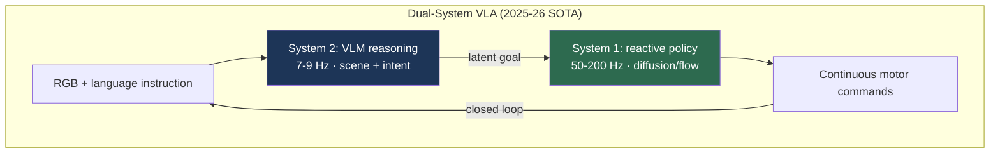
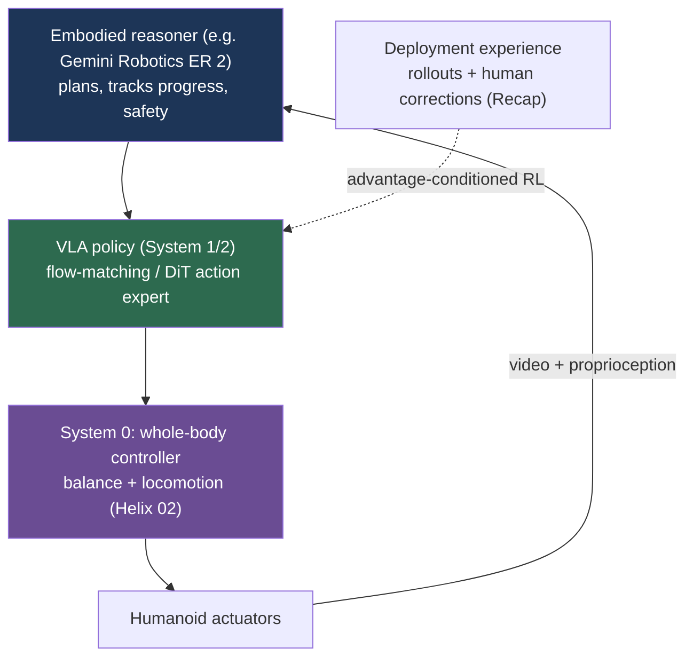

# VLA & Embodied AI: 2025–2026 State of the Art

> **Last Updated:** October 2026
> **Level:** Research Frontier
> **Related Sections:**
> - [VLA Models (foundations)](../06_robotics_and_embodied_ai/01_vla_models.md)
> - [Pros, Cons & Roadmaps](../06_robotics_and_embodied_ai/07_pros_cons_roadmaps.md)
> - [Generalist vs. Specialist](../06_robotics_and_embodied_ai/11_generalist_vs_specialist.md)
> - [Future Trends](./07_future_trends.md)

> **🆕 October 2026 update:**
> - Added the 2026 frontier: **Gemini Robotics 2 / ER 2** (July 2026, whole-body humanoid control), **Gemini Robotics-ER 1.6** (April 2026), **π\*0.6 / Recap** (Nov 2025, RL from experience) and **π0.7** (April 2026, early compositional generalization).
> - Updated the NVIDIA line: **GR00T N1.6** (Cosmos-Reason-2B VLM, 32-layer DiT) and **GR00T N1.7** (GA, Apache 2.0, pretrained on 20K hours of EgoScale human video).
> - Added **Figure Helix 02** (full-body System 0/1/2), **Generalist GEN-0 → GEN-1** (~500K hours of data), and a new subsection on open VLAs (SmolVLA, X-VLA, MolmoAct2, Qwen-VLA, LingBot-VLA, RDT2).
> - Added the rise of **World Action Models** (DreamZero, Cosmos Policy, Cosmos 3) and of real-world evaluation (RoboArena), and noted LIBERO saturation (π0.5 96.85%, Qwen-VLA 97.9%).
> - Expanded Key Papers, Benchmark, Pros & Cons, Open Problems and Further Reading.

---

## Overview

Where [VLA Models](../06_robotics_and_embodied_ai/01_vla_models.md) traces the architectural lineage from RT-1 to GR00T N1, this file captures the **deployment-grade state of the art as of late 2026**—the models that moved from research demos to real-world pilots, the benchmark numbers that define the current frontier, and the capabilities that remain unsolved. The defining shift of 2025 was the maturation of **dual-system architectures** (slow VLM reasoning + fast reactive control) into shipping products, and the arrival of VLAs from frontier-model labs (Google DeepMind's Gemini Robotics) that inherit the full capability of a flagship multimodal LLM.

Three quantitative themes characterize 2025–2026. First, **inference efficiency caught up to capability**: OpenVLA-OFT's 26× speedup (3–5 Hz → ~110 Hz) and π₀'s 50 Hz flow-matching control resolved the latency objection that dogged the first VLA generation. Second, **long-horizon dexterity became measurable**: Gemini Robotics reported 100% success on a 2-minute lunch-box-packing task and 79% average on a dexterous specialist suite. Third, **real-world deployment hours accumulated**: Figure's Helix assisted production of 30,000+ BMW X3s; 1X NEO and Unitree shipped thousands of units, beginning a genuine data flywheel (see [Pros, Cons & Roadmaps](../06_robotics_and_embodied_ai/07_pros_cons_roadmaps.md)).

The first three quarters of 2026 added three further shifts. (1) **From upper-body to whole-body control**: Figure's Helix 02 and Google DeepMind's Gemini Robotics 2 both moved a single learned policy from tabletop/upper-body manipulation to walking, crouching and manipulating as one system. (2) **From imitation to experience**: Physical Intelligence's π\*0.6 (Recap) showed that offline-RL-style advantage conditioning on autonomous rollouts plus human corrections roughly doubles throughput on hard tasks, and π0.7 reported the first signs of *compositional* task generalization. (3) **From robot-only data to human and video data**: GR00T N1.7 pretrains on 20K hours of egocentric human video, Generalist's GEN-1 on roughly half a million hours of human-worn "data hands" recordings, and a new class of **World Action Models** (WAMs) that predict video and actions jointly topped real-world leaderboards.

These results are recent and partly reported via technical reports and company blogs rather than peer-reviewed venues; where appropriate they should be treated as **preliminary / subject to independent replication**.

---

## The Current Frontier Models

### Gemini Robotics (Google DeepMind, 2025)

**Gemini Robotics** [GeminiRobotics2025] (arXiv:2503.20020, March 2025) was the first VLA built on a full frontier multimodal LLM (**Gemini 2.0**) rather than a smaller specialized VLM. Reported results: it **more than doubles** generalization-benchmark performance versus prior VLAs; specialist variants average **79% success** on a dexterous task suite; and a long-horizon lunch-box packing task (2+ minutes) reaches **100%**. It supports ALOHA 2, bi-arm Franka, and the Apptronik Apollo humanoid. A companion **Gemini Robotics-ER** (Embodied Reasoning) model targets spatial reasoning and achieves **2–3× the success rate** of the Gemini 2.0 baseline for end-to-end control. **Gemini Robotics On-Device** (June 2025) was a local, low-latency variant. **Gemini Robotics 1.5** (arXiv:2510.03342, Sept/Oct 2025) added "thinking before acting", advanced embodied reasoning via **Gemini Robotics-ER 1.5** (made available to developers through the Gemini API), and cross-embodiment **motion transfer**.

### Gemini Robotics-ER 1.6 and Gemini Robotics 2 / ER 2 (Google DeepMind, 2026)

**Gemini Robotics-ER 1.6** (mid-April 2026, Gemini API / Google AI Studio) focused on spatial logic, multi-view reasoning, stricter safety-instruction following and a new **instrument-reading** capability (gauges, meters, sight glasses) developed with Boston Dynamics for industrial inspection. Independent commentary noted the release itself contained few benchmark numbers.

**Gemini Robotics 2** [GeminiRobotics2-2026] (announced 30 July 2026) is a three-model suite:

- **Gemini Robotics 2** — a VLA that controls an *entire* humanoid rather than only the upper body; it was demonstrated on Apptronik's **Apollo 2** walking, crouching and placing objects on shelves in cluttered scenes. Coverage of DeepMind's announcement reported, for example, **45.7%** success on floor pick-ups and unscrewing a light bulb **92 times out of 100**, while DeepMind itself acknowledged that movement speed still needs work. Available to early-access partners.
- **Gemini Robotics ER 2** — the embodied-reasoning "high-level brain" (built on Gemini 3.5 Flash per its model card) that plans, tracks task progress from continuous video, coordinates multiple robots and hands motor execution to any lower-level VLA. Google reports **57.4%** on progress classification, **91.3%** accuracy (0.96 s mean absolute distance) on moment-finding, and **97.9%** on safety-instruction following versus **47.2%** for ER 1.6. Public preview in Google AI Studio / Gemini API.
- **Gemini Robotics On-Device 2** — a local model for rapid adaptation to new embodiments (offered to early-access partners).

### π₀.5 (Physical Intelligence, 2025)

**π₀.5** [PI2025] (arXiv:2504.16054) extends the flow-matching π₀ (PaliGemma backbone + continuous flow-matching action expert at 50 Hz) to **open-world generalization**—deployment in *novel homes never seen in training*, with improved language conditioning and longer-horizon mobile manipulation (cleaning a kitchen, making a bed). It is the strongest public evidence that VLA generalization is reaching Level 3–4 (environment and task transfer) of the framework in [Pros, Cons & Roadmaps](../06_robotics_and_embodied_ai/07_pros_cons_roadmaps.md). In **September 2025** π₀.₅ base and fine-tuned weights (trained with *knowledge insulation*) were released in the open-source **openpi** repository, together with PyTorch support; the openpi π₀.₅-LIBERO checkpoint reports **96.85%** average on LIBERO.

### π\*0.6 and Recap: Learning from Experience (Physical Intelligence, Nov 2025)

**π\*0.6** [PI2025b] (arXiv:2511.14759, 18 Nov 2025) introduces **Recap** (*RL with Experience and Corrections via Advantage-conditioned Policies*). A generalist VLA is pre-trained with offline RL, then specialized by collecting on-robot data that mixes demonstrations, autonomous on-policy rollouts and expert teleoperated **interventions** during autonomous execution; a learned value function scores actions and the policy is conditioned on advantage. On the hardest tasks (folding laundry in real homes, assembling boxes, making espresso drinks) Recap **roughly doubles throughput and roughly halves the failure rate**. It is the most prominent 2025 argument that VLAs can improve from their own deployment experience rather than only from more imitation data. Weights were not open-sourced.

### π0.7: Steerable Generalist with Early Compositional Generalization (Physical Intelligence, Apr 2026)

**π0.7** [PI2026] (arXiv:2604.15483, 16 April 2026) trains on prompts that contain not only the task description but **detailed language, generated subgoal images and episode metadata**, which lets it absorb a broad mix of robot and non-robot data. The company reports *early signs of compositional generalization*—recombining skills learned on different tasks to solve new ones, e.g., operating unfamiliar kitchen appliances and folding laundry on a robot platform with no laundry-folding data—while remaining competitive with specialized models. The team itself cautions that complex tasks still require step-by-step guidance rather than a single command.

### GR00T N1 / N1.5 / N1.6 / N1.7 (NVIDIA, 2025–2026)

**GR00T N1** [GR00T2025] (arXiv:2503.14734) is the open-weights humanoid dual-system VLA: an Eagle-2-based VLM (System 2) plus a diffusion-transformer action expert (System 1) running at **120 Hz**, with a full 16-action chunk computed in **63.9 ms on an L40 GPU**. Evaluated on RoboCasa Kitchen (24 tasks), DexMimicGen (9 cross-embodiment tasks), and real Fourier GR-1 hardware. **GR00T N1.5** (mid-2025) broadened training data across bimanual and humanoid embodiments and is distributed via GitHub and Hugging Face.

**GR00T N1.6** (late 2025 / early 2026) swapped in an internal **Cosmos-Reason-2B** VLM (native aspect ratio), doubled the DiT action head to **32 layers**, unfroze the top 4 VLM layers instead of using a post-VLM adapter, predicted **state-relative action chunks**, and added several thousand hours of teleoperation data (bimanual YAM, AgiBot Genie-1, simulated Galaxea R1 Pro on BEHAVIOR, whole-body loco-manipulation on Unitree G1). **GR00T N1.7** (2026, **general availability**, commercially licensable under **Apache 2.0**) moves to **Cosmos-Reason2-2B (Qwen3-VL architecture)**, adopts a **relative end-effector action space shared by human and robot embodiments**, expands the action horizon from 16 to 40, and pretrains on **20K hours of EgoScale human video**—NVIDIA reports comparable performance to N1.6 with better generalization and language following. Inference runs on a single 16 GB+ GPU, including **Jetson AGX Thor/Orin**. NVIDIA has also previewed a next-generation **GR00T N2** (reported; details not yet public).

### Helix and Helix 02 (Figure AI, 2025–2026)

**Helix** [Figure2025] is the production dual-system controller for the Figure 02 humanoid: an internet-pretrained VLM (System 2) at **7–9 Hz** feeding latent goals to a **200 Hz** visuomotor policy (System 1) controlling 35 upper-body DoF. Deployed at BMW Spartanburg, it assisted production of **30,000+ X3s** over a 10-month pilot—the most extensive real-world humanoid-VLA deployment publicly documented.

**Helix 02** [Figure2026] (early 2026, on the Figure 03 humanoid) extends neural control from the upper body to the **whole body** with a three-level hierarchy: a new **System 0**—a learned whole-body controller trained on 1,000+ hours of human motion data plus sim-to-real RL—below the 200 Hz System 1 and the VLM System 2. Figure's flagship demo is a **four-minute autonomous dishwasher unload/reload** comprising dozens of locomotion and manipulation actions without resets or teleoperation (claimed as the longest-horizon autonomous humanoid task to date), plus tactile- and palm-camera-enabled fine manipulation. All figures are company-reported.

### Generalist AI: GEN-0 and GEN-1 (2025–2026)

**GEN-0** (Generalist AI, Nov 2025) was presented as a proof of concept for **scaling laws in robot manipulation**, pre-trained on ~**270,000 hours** of real-world manipulation data collected largely with wearable "data hands" grippers worn by humans. **GEN-1** (April 2026) was trained from scratch on roughly **half a million hours** of such data; Generalist reports raising average success to **99%** on tasks where previous models reached 64%, ~**3× faster** task completion, and only ~1 hour of robot data per task. The company itself notes GEN-1 targets short (typically sub-minute) tasks and "cannot solve all tasks today."

### OpenVLA-OFT (2025)

**OpenVLA-OFT** (Optimized Fine-Tuning) addressed the base OpenVLA's principal weakness—**3–5 Hz autoregressive latency**—via parallel decoding and 8-step action chunking, reaching **109.7 Hz** (0.073 s/chunk, a **26× speedup**) and **97.1% average on LIBERO** (Spatial 97.6 / Object 98.4 / Goal 97.9 / Long 94.5). It remains a widely used *open-source* baseline for accessibility and fine-tunability, though by 2026 several open VLAs match it on LIBERO (see below).

### The Open-VLA Ecosystem (2025–2026)

The open ecosystem broadened substantially, largely consolidated in Hugging Face **LeRobot**, which by 2026 ships π₀/π₀-FAST/π₀.₅, GR00T N1.7, SmolVLA, X-VLA, MolmoAct2, WALL-OSS and others behind one interface:

- **SmolVLA** (Hugging Face, arXiv:2506.01844, 2025) — a compact (~0.45B) VLA designed for affordable hardware and community-collected LeRobot datasets.
- **X-VLA** (2025) — a soft-prompted flow-matching VLA that encodes each robot/dataset as learnable embeddings; X-VLA-0.9B is trained on 290K episodes from seven platforms and reaches near-π₀ performance on LIBERO and Simpler-WidowX while tuning only ~9M parameters for a new robot.
- **MolmoAct2** (Ai2, arXiv:2605.02881, May 2026) — fully open "action reasoning" models built on the **Molmo2-ER** embodied-reasoning VLM with a flow-matching action expert; a *Think* variant reasons over compact depth tokens before acting; released with datasets and training code.
- **Qwen-VLA** (Qwen team, arXiv:2605.30280, 2026) — a **Qwen3.5-4B** backbone plus a **1.15B DiT flow-matching** action decoder that unifies manipulation, navigation and trajectory prediction with embodiment-aware prompts; a single generalist reports **97.9%** on LIBERO and matches or beats per-benchmark specialists.
- **LingBot-VLA** (Ant Group, Jan 2026) — pre-trained on **20,000 hours** of real data from nine dual-arm configurations; **RDT2** (Tsinghua, arXiv:2602.03310) — scales UMI hand-held-gripper data toward zero-shot cross-embodiment generalization.

### World Action Models: Video Models as Policies (2026)

A distinct 2026 trend is the **World Action Model (WAM)**: a video-generation backbone that jointly predicts future frames and actions. **Cosmos Policy** (NVIDIA, arXiv:2601.16163) fine-tunes the Cosmos video model to output actions, future states and values, enabling best-of-N model-based planning. **DreamZero** (NVIDIA GEAR, arXiv:2602.15922) reported **#1 on both the RoboArena and MolmoSpaces leaderboards** in February 2026 with a DROID model trained from scratch, and few-shot adaptation from ~30 minutes of play data. NVIDIA's **Cosmos 3** (May 2026) unifies reasoning, world prediction, transfer and action generation in one model family (64B Super / 16B Nano / 4B Edge). This line connects VLAs directly to the [world models](../06_robotics_and_embodied_ai/02_world_models.md) and [4D scene](./05_4d_and_dynamic_scenes.md) literature.

---

## Key Papers

| Paper | Authors | Year | Venue | Key Contribution |
|-------|---------|------|-------|-----------------|
| Gemini Robotics | Gemini Robotics Team (DeepMind) | 2025 | arXiv:2503.20020 | Frontier-LLM-backed VLA; 79% specialist, 100% lunch-box |
| Gemini Robotics 1.5 | Gemini Robotics Team | 2025 | arXiv:2510.03342 | Embodied reasoning + motion transfer |
| π₀.5 | Physical Intelligence | 2025 | arXiv:2504.16054 | Open-world generalization to novel homes |
| π\*0.6: a VLA That Learns From Experience | Physical Intelligence | 2025 | arXiv:2511.14759 | Recap: advantage-conditioned RL from rollouts + corrections; ~2× throughput |
| π0.7: a Steerable Generalist Robotic Foundation Model | Physical Intelligence | 2026 | arXiv:2604.15483 | Rich multimodal prompting; early compositional generalization |
| GR00T N1 | NVIDIA | 2025 | arXiv:2503.14734 | Open dual-system humanoid VLA; 120 Hz System 1 |
| OpenVLA-OFT | Kim, Pertsch, et al. | 2025 | arXiv:2502.19645 | 26× inference speedup; 97.1% LIBERO |
| SmolVLA | Shukor, Aubakirova, et al. (Hugging Face) | 2025 | arXiv:2506.01844 | Compact, affordable open VLA for LeRobot community data |
| Cosmos Policy | NVIDIA | 2026 | arXiv:2601.16163 | Fine-tunes a video world model into a policy + planner |
| DreamZero: World Action Models Are Zero-Shot Policies | NVIDIA GEAR | 2026 | arXiv:2602.15922 | Joint video+action prediction; #1 RoboArena (Feb 2026) |
| MolmoAct2 | Ai2 | 2026 | arXiv:2605.02881 | Fully open action-reasoning VLA on Molmo2-ER |
| Qwen-VLA | Qwen Team | 2026 | arXiv:2605.30280 | Unified manipulation + navigation generalist; 97.9% LIBERO |

---

## Benchmark Performance

| Model | Benchmark | Metric | Score | Notes |
|-------|-----------|--------|-------|-------|
| Gemini Robotics | Dexterous specialist suite | Avg success | 79% | Preliminary [GeminiRobotics2025] |
| Gemini Robotics | Lunch-box packing (2 min) | Success | 100% | Long-horizon |
| Gemini Robotics-ER | End-to-end control | vs Gemini 2.0 | 2–3× | Embodied reasoning variant |
| Gemini Robotics ER 2 | Safety-instruction following | Accuracy | 97.9% | vs 47.2% for ER 1.6; Google-reported |
| Gemini Robotics ER 2 | Moment-finding (video) | Accuracy | 91.3% | 0.96 s mean abs. distance; Google-reported |
| Gemini Robotics 2 | Whole-body floor pick-up (Apollo 2) | Success | 45.7% | Reported in launch coverage; preliminary |
| π\*0.6 (Recap) | Laundry / box assembly / espresso | Throughput, failure rate | ~2× / ~0.5× | vs. pre-Recap policy; company-reported |
| OpenVLA-OFT | LIBERO (avg) | Success | 97.1% | Spatial/Object/Goal/Long |
| π₀.₅ (openpi, fine-tuned) | LIBERO (avg) | Success | 96.85% | 98.8 / 98.2 / 98.0 / 92.4 |
| Qwen-VLA-Instruct | LIBERO (avg) | Success | 97.9% | Single generalist, no per-benchmark tuning |
| OpenVLA-OFT | Inference | Control rate | 109.7 Hz | 0.073 s / 8-action chunk |
| GR00T N1 | Inference (L40) | Latency | 63.9 ms / 16 actions | System 1 at 120 Hz |
| π₀ | Real dexterous tasks | Control rate | 50 Hz | Flow-matching, smooth |
| Helix | BMW Spartanburg pilot | Vehicles assisted | 30,000+ X3s | 10-month deployment |
| GEN-1 | Generalist task suite | Avg success | 99% (vs 64%) | Company-reported; short tasks |
| DreamZero | RoboArena (real-world, distributed) | Leaderboard rank | #1 (Feb 2026) | Also #1 on MolmoSpaces |

*LIBERO is now effectively saturated (several models ≥ 97%); distributed real-world evaluation such as RoboArena is becoming the more informative comparison.*

---

## Pros & Cons

| Aspect | Pros | Cons |
|--------|------|------|
| Frontier-LLM VLAs (Gemini Robotics 1.5/2) | Inherit full multimodal reasoning; SOTA generalization; now whole-body | Closed weights; massive compute; replication hard; early-access only |
| Open dual-system (GR00T N1.6/N1.7) | Open weights (Apache 2.0 for N1.7), humanoid-optimized, human-video pretraining, Jetson Thor deployment | Platform-specific tuning; comparable-not-better performance vs N1.6 on robot benchmarks |
| Flow-matching (π₀/π₀.5/π0.7) | Smooth high-frequency dexterity; open-world and early compositional generalization | Data-hungry; π\*0.6 and π0.7 closed |
| RL from experience (π\*0.6 Recap) | Improves from deployment; fewer failures, higher throughput | Needs human interventions and value-function training per task family |
| Open-source (OpenVLA-OFT, SmolVLA, X-VLA, MolmoAct2, Qwen-VLA) | Accessible, fine-tunable, fast; LIBERO parity with closed models | Lower dexterity ceiling than π/Gemini on real long-horizon tasks |
| World Action Models (DreamZero, Cosmos Policy) | Leverage video pretraining; strong zero-shot real-world results | Heavy inference (seconds per step on H100 without caching); young methodology |

---

## Open Problems & Research Gaps

- **Level-5 compositional reasoning** (multi-step plans needing world knowledge) is still largely unsolved; reported successes are mostly L1–L4 (see the generalization framework in [Pros, Cons & Roadmaps](../06_robotics_and_embodied_ai/07_pros_cons_roadmaps.md)). π0.7 shows only *early* signs of compositional task generalization and still needs step-by-step prompting.
- **Replication of company-reported numbers.** Gemini Robotics 2, π\*0.6/π0.7, Helix 02 and GEN-1 results come from non-peer-reviewed reports on proprietary hardware; independent replication is scarce.
- **Spatial grounding.** Even SOTA VLAs inherit the spatial-reasoning failures of their VLM backbones (see [Spatial Intelligence](./06_spatial_intelligence.md)).
- **On-device deployment.** Frontier VLAs require server-class GPUs; compressing them to Jetson-Thor budgets without large accuracy loss is open (see [Future Trends](./07_future_trends.md)). GR00T N1.7, Gemini Robotics On-Device 2 and Cosmos3-Edge are first steps.
- **Failure recovery and safety.** Long-horizon deployments expose compounding errors; robust recovery and certified safety remain immature. ER 2's high safety-instruction scores are self-reported and not a substitute for physical safety certification.
- **Whole-body control at speed.** Whole-body VLAs (Helix 02, Gemini Robotics 2) are slower than humans and success drops sharply for floor-level and highly dexterous sub-tasks.
- **Learning from deployment at scale.** Recap-style RL requires value functions and human interventions; making it scale across thousands of tasks and fleets is open.
- **The dexterity–generality trade-off.** No single model yet matches π₀'s dexterity *and* Gemini's broad reasoning—convergence is anticipated but unproven.
- **Evaluation standardization.** LIBERO/RoboCasa are simulation-biased and now saturated; distributed real-world arenas (RoboArena) are promising but still small and DROID-centric.

---

## Further Reading

- [Gemini Robotics (arXiv:2503.20020)](https://arxiv.org/abs/2503.20020) — frontier-LLM-backed VLA
- [Gemini Robotics 1.5 (arXiv:2510.03342)](https://arxiv.org/abs/2510.03342) — thinking VLA, ER 1.5, motion transfer
- [Gemini Robotics 2 brings whole body intelligence to robots (DeepMind blog)](https://deepmind.google/blog/gemini-robotics-2-brings-whole-body-intelligence-to-robots/) — July 2026 suite
- [Gemini Robotics ER 2 model card](https://deepmind.google/models/model-cards/gemini-robotics-er-2/) — embodied reasoning model
- [π₀.5 (arXiv:2504.16054)](https://arxiv.org/abs/2504.16054) — open-world generalization
- [π\*0.6 / Recap (arXiv:2511.14759)](https://arxiv.org/abs/2511.14759) — VLA that learns from experience
- [π0.7 (arXiv:2604.15483)](https://arxiv.org/abs/2604.15483) and [blog](https://www.pi.website/blog/pi07) — steerable generalist with emergent capabilities
- [openpi](https://github.com/Physical-Intelligence/openpi) — open π₀ / π₀-FAST / π₀.₅ weights
- [GR00T N1 (arXiv:2503.14734)](https://arxiv.org/abs/2503.14734) and [Isaac-GR00T (N1.7)](https://github.com/NVIDIA/Isaac-GR00T) — open dual-system humanoid VLA
- [OpenVLA-OFT (arXiv:2502.19645)](https://arxiv.org/abs/2502.19645) — efficient open-source VLA
- [Figure Helix](https://www.figure.ai/news/helix) and [Helix 02](https://figure.ai/news/helix-02) — production dual-system and full-body humanoid control
- [Generalist GEN-1](https://generalistai.com/blog/gen-1) — scaling real-world manipulation data
- [LeRobot](https://github.com/huggingface/lerobot) — open VLA policies (SmolVLA, X-VLA, MolmoAct2, GR00T, π)
- [MolmoAct2](https://github.com/allenai/molmoact2) and [Qwen-VLA](https://github.com/QwenLM/Qwen-VLA) — 2026 open VLAs
- [DreamZero](https://github.com/dreamzero0/dreamzero) and [Cosmos Policy (arXiv:2601.16163)](https://arxiv.org/abs/2601.16163) — World Action Models
- [RoboArena](https://robo-arena.github.io/) — distributed real-world evaluation of generalist policies
