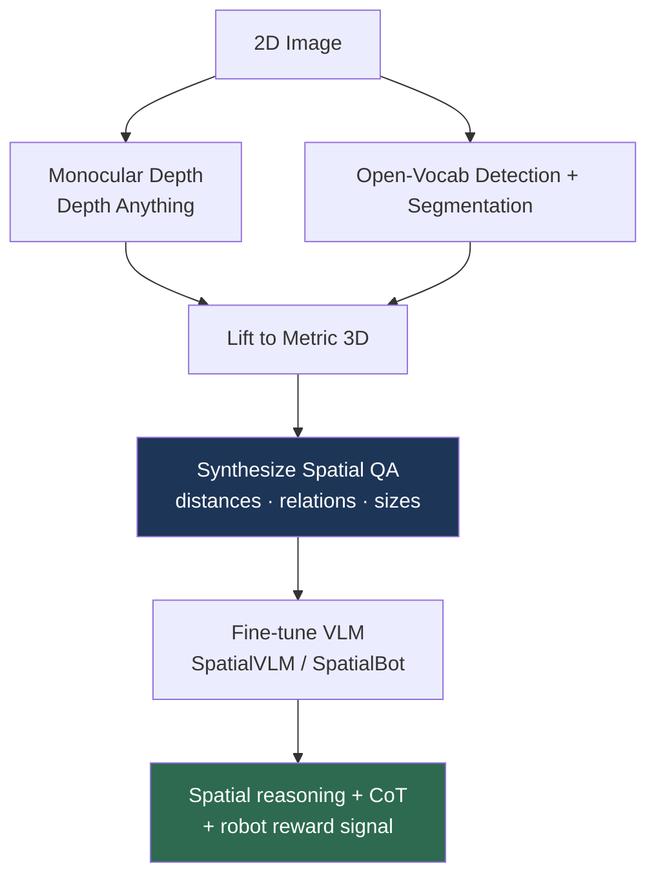
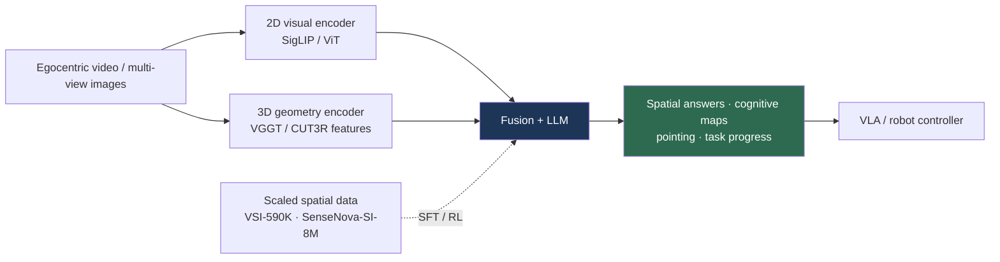

# Spatial Intelligence

> **Last Updated:** October 2026
> **Level:** Research Frontier
> **Related Sections:**
> - [Perception for Robotics](../06_robotics_and_embodied_ai/08_perception_for_robotics.md)
> - [Large Vision-Language Models](../05_multimodal_vision_language/02_large_vision_language_models.md)
> - [4D & Dynamic Scenes](./05_4d_and_dynamic_scenes.md)
> - [Future Trends](./07_future_trends.md)

> **🆕 October 2026 update:**
> - Added the 2025–2026 benchmark wave: **VSI-Bench** (CVPR 2025 Oral), **VSI-SUPER**, MMSI-Bench, MindCube, SITE, ViewSpatial and others, with a table of representative scores (GPT-5, Gemini 2.5 Pro, Qwen3-VL, Cambrian-S, SenseNova-SI).
> - New subsections on **data scaling** (Cambrian-S / VSI-590K, SenseNova-SI-8M, CVPR 2026), **geometry-aware MLLMs** (Spatial-MLLM, VLM-3R, SpatialLM, VST) and **reconstruction as a proxy task** (VGGT-Ω).
> - Added **embodied-reasoning models** (Gemini Robotics-ER 1.5 / 1.6 / ER 2, Molmo2-ER, Cosmos Reason) and **World Labs Marble** as spatial intelligence expressed through world generation.
> - New open problems on non-visual benchmark shortcuts and long-horizon "supersensing".

---

## Overview

"Spatial intelligence" denotes the capacity to perceive, represent, and reason about the geometric and physical structure of the 3D world—relative positions (left/right, above/below, in front/behind), metric distances and sizes, occlusion and containment, and how these change under viewpoint or action. It is the conspicuous failure mode of otherwise impressive large multimodal models: a VLM that can write a sonnet about an image frequently cannot reliably answer whether the mug is to the left or right of the laptop, or which of two objects is closer to the camera. Fei-Fei Li has framed spatial intelligence as the *next frontier* of AI and the founding thesis of World Labs, arguing that language-centric intelligence is fundamentally incomplete without a grounded model of space; her November 2025 essay *From Words to Worlds* restated this thesis as the case for "world models" that are generative, multimodal and interactive.

The deficit has a clear cause. Contrastive image-text pretraining (CLIP-style, the backbone of most VLMs—see [Large Vision-Language Models](../05_multimodal_vision_language/02_large_vision_language_models.md)) optimizes for semantic alignment between captions and images. Captions rarely encode precise spatial relations ("a cat" not "a cat 1.2 m left of and nearer than the sofa"), so the learned representations capture *what* is present far better than *where* it is and *how big* it is. Compounding this, 2D image tokens discard the metric depth that spatial reasoning requires. The result is a model that is semantically rich but geometrically impoverished—a critical liability for embodied AI, where every manipulation and navigation decision is fundamentally spatial (see [Perception for Robotics](../06_robotics_and_embodied_ai/08_perception_for_robotics.md)).

This file surveys the diagnosis of the spatial deficit, the data- and architecture-level remedies proposed in 2024–2026 (SpatialVLM, SpatialBot, 3D-LLM, SpatialRGPT), the benchmarks that quantify it, and why solving it is a prerequisite for useful household robots.

Between mid-2025 and late 2026 the field changed character in four ways. (1) **Evaluation moved from single images to video and multi-view**: VSI-Bench, MMSI-Bench, MindCube and VSI-SUPER probe whether models can build and maintain a spatial representation over time and across viewpoints. (2) **Spatial data was scaled by an order of magnitude**: Cambrian-S (VSI-590K) and SenseNova-SI (8M samples) show that 7–8B open models trained on curated spatial data now *exceed* GPT-5 and Gemini 2.5 Pro on several spatial benchmarks. (3) **3D geometry entered the MLLM**: encoders from feed-forward reconstruction models (VGGT, CUT3R) are fused into VLMs, and VGGT-Ω argues that reconstruction itself is a scalable proxy task for spatial understanding. (4) **Spatial reasoning became a product layer for robots**: embodied-reasoning models (Gemini Robotics-ER 1.5 → ER 2, Molmo2-ER, Cosmos Reason) act as the "spatial brain" above VLA controllers.

---

## The Spatial Deficit: Diagnosis

Spatial reasoning failures fall into several categories: **relational** (left/right, above/below—often near chance because of training-data symmetry and horizontal-flip augmentation that destroys left/right consistency), **metric** (distances, object sizes), **perspective/egocentric** (reasoning from the robot's viewpoint vs. an allocentric map), and **counting** (which degrades with clutter). Benchmarks such as **VSR** (Visual Spatial Reasoning), **What'sUp**, **BLINK**, **SQA3D**, and **EmbodiedScan** isolate these, and consistently show frontier VLMs scoring far below human level on relational and metric items even when they excel at captioning and VQA.

**Video and multi-view diagnosis (2025).** *Thinking in Space* [Yang2025] (NYU/Yale/Stanford, CVPR 2025 Oral) introduced **VSI-Bench**: over 5,000 QA pairs from 288 egocentric videos of real indoor scenes (ScanNet, ScanNet++, ARKitScenes) covering eight tasks in three families—*configurational* (relative direction, route planning), *measurement* (object/room size, absolute distance) and *spatiotemporal* (appearance order). Evaluating 15 video MLLMs zero-shot, it found that models form only local "cognitive maps", that spatial reasoning (not perception or language) is the main bottleneck, and that standard linguistic chain-of-thought prompting does *not* help. Follow-up benchmarks broadened the diagnosis: **MMSI-Bench** (multi-image spatial intelligence), **MindCube** (forming spatial mental models from a few views), **SITE** (ICCV 2025), **ViewSpatial-Bench** (multi-perspective localization), **OmniSpatial**, **SpaCE-10** (compositional spatial intelligence) and **DSI-Bench** (dynamic spatial intelligence). An August 2025 empirical study, *Has GPT-5 Achieved Spatial Intelligence?*, found GPT-5 to be the strongest general model on many of these suites yet still clearly below human performance on most spatial tasks.

---

## Remedies

### Data Generation: SpatialVLM

**SpatialVLM** [Chen2024] (Google, CVPR 2024) attributes the deficit primarily to a *training-data gap* rather than an architectural limit. Its remedy is a **3D data-generation pipeline**: lift internet images to metric 3D using monocular depth ([Depth Anything](./02_any_model_paradigm.md)-style), open-vocabulary detection, and segmentation, then automatically synthesize millions of spatial QA pairs ("How far is the chair from the table?", "Is the cup left of the plate?"). Fine-tuning a VLM on this synthetic corpus substantially improves quantitative and qualitative spatial reasoning and, notably, enables **chain-of-thought spatial reasoning** and use as a reward signal for robotics.

### Depth-Augmented Architectures: SpatialBot & SpatialRGPT

**SpatialBot** [Cai2024] explicitly feeds *both RGB and depth* to the VLM and trains on a SpatialQA dataset spanning low-to-high-level spatial understanding, arguing that depth must be an *input modality*, not something inferred implicitly. **SpatialRGPT** extends this with region-level 3D representations and a flexible plugin for depth, improving relative-direction and distance estimation.

### Explicit 3D Grounding: 3D-LLM

**3D-LLM** [Hong2023] (NeurIPS 2023) injects 3D point clouds and their features directly into an LLM, training on 3D-language tasks (3D captioning, 3D QA, navigation, embodied dialogue). By grounding the language model in an explicit 3D representation rather than 2D projections, it targets the perspective and metric deficits at their root—at the cost of requiring 3D input that is not always available. **SpatialLM** (Manycore Research, NeurIPS 2025) is a practical descendant: a small (0.5–1B) 3D LLM that turns point clouds—including ones reconstructed from monocular video—into structured scene layouts (walls, doors, windows, oriented object boxes).

### Scaling Spatial Data: Cambrian-S and SenseNova-SI (2025–2026)

**Cambrian-S** [YangS2025] (NYU and collaborators including Yann LeCun, Fei-Fei Li and Saining Xie; arXiv:2511.04670, Nov 2025) frames the goal as **spatial supersensing**—moving beyond seeing and captioning toward building, maintaining and *predicting* a spatial world state across arbitrarily long video. It contributes **VSI-590K**, a spatial video instruction-tuning set, the Cambrian-S model family (Cambrian-S-7B reaches **67.5** on VSI-Bench), and **VSI-SUPER**, a long-horizon benchmark of spatial recall and continual counting over very long videos on which brute-force context extension fails. Its variant **Cambrian-S-7B-LFP** adds *latent frame prediction*: the model predicts its next latent observation and uses **surprise** (prediction error) to decide what to remember and how to segment events—an early instance of predictive sensing in MLLMs. A companion paper (Brown et al., arXiv:2511.04655) argues that benchmark designers should deliberately "train on the test set" to expose **non-visual shortcuts** that let models answer spatial questions without looking.

**SenseNova-SI** [Cai2026] (SenseTime and collaborators; arXiv:2511.13719; **CVPR 2026**) systematically scales spatial data to **SenseNova-SI-8M** (~8.16M samples over ~2.72M images, organized by a taxonomy of spatial capabilities) and fine-tunes several bases (InternVL3, Qwen3-VL, BAGEL). The 8B models set open-source state of the art across eight spatial benchmarks (the "EASI-8": VSI, MMSI, MindCube, ViewSpatial, SITE, BLINK, 3DSRBench, EmbSpatial) and, on several, beat GPT-5 (see the table below). The report also documents emergent generalization from diverse data, the risk of overfitting and language shortcuts, and only modest benefits from spatial chain-of-thought.

### Geometry-Aware MLLMs and Reconstruction as a Proxy Task

A second 2025 line equips MLLMs with **3D-geometry encoders** taken from feed-forward reconstruction models (see [4D & Dynamic Scenes](./05_4d_and_dynamic_scenes.md)): **Spatial-MLLM** (NeurIPS 2025) pairs a standard 2D visual encoder with a spatial encoder initialized from VGGT, plus space-aware frame sampling; **VLM-3R** injects instruction-aligned 3D reconstruction tokens from a CUT3R-style model; **Visual Spatial Tuning (VST)** builds large spatial perception and reasoning corpora with RL. **VGGT-Ω** (Oxford VGG + Meta, CVPR 2026 Best Paper Finalist) pushes the argument further: its reconstruction registers can be *aligned with language* and *improve VLA policies*, suggesting that **3D reconstruction is a scalable, label-efficient proxy task for spatial understanding**.

### Embodied-Reasoning Models: Spatial Intelligence as a Robot "Brain"

Robotics labs now ship dedicated spatial/embodied-reasoning VLMs that sit above action policies (see [VLA & Embodied AI 2025–2026](./04_vla_embodied_2025_2026.md)). **Gemini Robotics-ER 1.5** (Sept 2025, Gemini API) provides pointing, 2D/3D detection, trajectory and task-progress reasoning; **ER 1.6** (April 2026) emphasizes spatial logic, multi-view reasoning and instrument reading; **Gemini Robotics ER 2** (July 2026) adds continuous-video progress tracking and multi-robot coordination. Open counterparts include Ai2's **Molmo2-ER** (the embodied-reasoning backbone of MolmoAct2, released with its spatial/3D training data) and NVIDIA's **Cosmos Reason / Cosmos-Reason2**, a physical-common-sense reasoning VLM that also serves as the VLM backbone of GR00T N1.6/N1.7.

### Spatial Intelligence as World Generation: World Labs Marble

World Labs operationalizes Fei-Fei Li's thesis generatively. After RTFM (*A Real-Time Frame Model*, Oct 2025), it launched **Marble** commercially in **November 2025**: a multimodal world model that turns text, images, video or coarse 3D layouts into persistent, editable 3D worlds exportable as Gaussian splats, meshes or video (rendered on the web with its open-source **Spark** Gaussian-splatting renderer for THREE.js). Marble is not a reasoning benchmark entrant, but it reflects the same bet: that a model which can *construct* consistent 3D space is a foundation for spatial reasoning, simulation and robotics.

---

## Key Papers

| Paper | Authors | Year | Venue | Key Contribution |
|-------|---------|------|-------|-----------------|
| SpatialVLM | Chen, Xu, Zheng, et al. (Google) | 2024 | CVPR | 3D-grounded synthetic spatial-QA data pipeline |
| SpatialBot | Cai, Liu, et al. | 2024 | arXiv→ICRA | RGB+depth input for precise spatial understanding |
| SpatialRGPT | Cheng, Yin, et al. | 2024 | NeurIPS | Region-level 3D representations + depth plugin |
| 3D-LLM | Hong, Zhen, Chen, et al. | 2023 | NeurIPS | Injects 3D point clouds into LLMs for 3D-language tasks |
| BLINK | Fu, Hu, Li, et al. | 2024 | ECCV | Benchmark exposing VLM perceptual/spatial blind spots |
| Thinking in Space (VSI-Bench) | Yang, Yang, Gupta, Han, Fei-Fei, Xie | 2025 | CVPR (Oral) | Video spatial-intelligence benchmark; cognitive-map analysis |
| MMSI-Bench | Xu et al. | 2025 | arXiv:2505.23764 | Multi-image spatial intelligence benchmark |
| Spatial Mental Modeling from Limited Views (MindCube) | (MindCube team) | 2025 | arXiv:2506.21458 | Tests building spatial mental models from few views |
| Spatial-MLLM | (Spatial-MLLM team) | 2025 | NeurIPS | Dual 2D + VGGT-initialized spatial encoder for MLLMs |
| SpatialLM | Manycore Research | 2025 | NeurIPS | 3D LLM producing structured layouts from point clouds |
| Cambrian-S: Towards Spatial Supersensing in Video | Yang, Yang, Huang, Brown, …, Fergus, LeCun, Fei-Fei, Xie | 2025 | arXiv:2511.04670 | VSI-590K, VSI-SUPER; predictive (latent-frame) sensing |
| Scaling Spatial Intelligence with Multimodal Foundation Models (SenseNova-SI) | Cai, Wang, Gu, …, Lin, Yang | 2026 | CVPR | 8M-sample spatial data scaling; open SOTA on EASI-8 |
| VGGT-Ω | Wang, Chen, …, Vedaldi, Rupprecht | 2026 | CVPR (Best Paper Finalist) | Reconstruction as scalable proxy for spatial understanding |

---

## Benchmark Performance

| Benchmark | Probes | Observation |
|-----------|--------|-------------|
| VSR | 65 spatial relations | Frontier VLMs near chance on many relational items |
| BLINK | Perceptual/spatial | Large human–model gap despite strong VQA scores |
| SQA3D | Situated 3D QA | Egocentric/perspective reasoning remains weak |
| EmbodiedScan | 3D grounding | Multi-modal 3D perception benchmark for embodied AI |
| SpatialVLM eval | Distance/relation QA | Synthetic-data fine-tuning yields large gains |
| VSI-Bench | Video configurational / measurement / spatiotemporal | Spatial-data fine-tuned 7–8B models (~67–69) now exceed GPT-5 (55.0) |
| MMSI-Bench | Multi-image spatial reasoning | Still hard: best models ~40–43 |
| MindCube | Mental modeling from limited views | Very sensitive to targeted data (≈30–57 → ~90 after spatial SFT) |
| VSI-SUPER | Long-horizon spatial recall + counting | Designed so that longer context alone does not solve it |

**Representative 2025–2026 scores** (as reported in the SenseNova-SI repository under a common EASI evaluation; higher is better):

| Model | VSI-Bench | MMSI | MindCube-Tiny | ViewSpatial | SITE |
|-------|-----------|------|---------------|-------------|------|
| GPT-5 (2025-08-07) | 55.0 | 41.8 | 56.3 | 45.5 | 61.8 |
| Gemini-2.5-Pro (2025-06) | 53.5 | 38.0 | 57.6 | 46.0 | 57.0 |
| Qwen3-VL-8B-Instruct | 57.9 | 31.1 | 29.4 | 42.2 | 45.8 |
| Cambrian-S-7B | 67.5 | 25.8 | 39.6 | 40.9 | 33.0 |
| VST-7B-SFT | 60.6 | 32.0 | 39.7 | 50.5 | 39.6 |
| SenseNova-SI-1.3-InternVL3-8B | 68.6 | 42.5 | 89.9 | 61.3 | 47.5 |

*Exact leaderboard numbers move quickly; treat specific scores as preliminary and consult current leaderboards. Specialist gains on in-distribution formats (e.g., MindCube) partly reflect training-data overlap in task style, and general models still lead on some suites (e.g., GPT-5 on SITE).*

---

## Pros & Cons

| Aspect | Pros | Cons |
|--------|------|------|
| Synthetic 3D data (SpatialVLM) | Scales without 3D annotation; large gains | Quality bounded by depth/detector accuracy |
| Depth as input (SpatialBot) | Direct metric grounding | Requires depth sensor/estimator at inference |
| Explicit 3D (3D-LLM, SpatialLM) | Root-cause grounding; perspective-aware | Needs 3D input; heavier pipeline |
| 2D-only VLMs | Cheap, ubiquitous | Persistent relational/metric failures |
| Large curated spatial data (Cambrian-S, SenseNova-SI) | Open 7–8B models beat frontier closed models on several benchmarks | Risk of format overfitting and language shortcuts; gains uneven across benchmarks |
| Geometry encoders in MLLMs (Spatial-MLLM, VLM-3R, VGGT-Ω) | Metric, multi-view-consistent features; reconstruction is self-supervisable | Extra compute; dynamic scenes and long videos still hard |
| Embodied-reasoning models (Gemini Robotics-ER, Molmo2-ER, Cosmos Reason) | Directly usable by robots (pointing, progress, safety) | Mostly vendor-evaluated; closed variants hard to audit |

---

## Open Problems & Research Gaps

- **Egocentric vs. allocentric reasoning.** Robots need viewpoint-dependent spatial reasoning; most benchmarks and fixes target allocentric, third-person relations. ViewSpatial-Bench and MindCube make this measurable, but perspective-taking remains a weak point.
- **Metric grounding from monocular input.** Reliable absolute (not just relative) distance/size from a single RGB image is unsolved at VLM scale.
- **Compositional spatial language.** Chained relations ("the box behind the leftmost cup nearest the window") still break.
- **Dynamic spatial reasoning.** Reasoning about how spatial relations change under the robot's own actions links spatial intelligence to [World Models](../06_robotics_and_embodied_ai/02_world_models.md) and [4D scenes](./05_4d_and_dynamic_scenes.md)—largely unaddressed; DSI-Bench is an early probe.
- **Long-horizon "supersensing".** Maintaining a persistent spatial memory over hours of video (VSI-SUPER) cannot be solved by longer context windows alone; predictive, surprise-driven memory is a promising but immature direction.
- **Benchmark saturation vs. generalization.** Fine-tuning on synthetic spatial QA can overfit benchmark formats without genuine geometric understanding; Cambrian-S and SenseNova-SI both document non-visual/language shortcuts.
- **Tactile/3D fusion.** Integrating non-visual spatial cues (proprioception, touch) into VLM spatial reasoning is immature.
- **Transfer from spatial QA to action.** Higher VSI-Bench scores do not yet demonstrably translate into better manipulation success; closing the loop between spatial reasoning models and VLA controllers is open.
- **Evaluation of "true" spatial understanding** vs. dataset-pattern exploitation remains an open methodological problem.

---

## Further Reading

- [SpatialVLM (arXiv:2401.12168)](https://arxiv.org/abs/2401.12168) — endowing VLMs with spatial reasoning via synthetic 3D data
- [SpatialBot (arXiv:2406.13642)](https://arxiv.org/abs/2406.13642) — precise spatial understanding with depth input
- [3D-LLM (arXiv:2307.12981)](https://arxiv.org/abs/2307.12981) — injecting 3D into large language models
- [BLINK (arXiv:2404.12390)](https://arxiv.org/abs/2404.12390) — perceptual/spatial blind spots of multimodal LLMs
- [World Labs (Fei-Fei Li)](https://www.worldlabs.ai/) — spatial intelligence as a founding thesis; Marble world model
- [Thinking in Space / VSI-Bench (arXiv:2412.14171)](https://github.com/vision-x-nyu/thinking-in-space) — video spatial-intelligence benchmark
- [Cambrian-S (arXiv:2511.04670)](https://github.com/cambrian-mllm/cambrian-s) — spatial supersensing, VSI-590K, VSI-SUPER
- [Benchmark designers should "train on the test set" (arXiv:2511.04655)](https://arxiv.org/abs/2511.04655) — exposing non-visual shortcuts
- [SenseNova-SI (arXiv:2511.13719)](https://github.com/OpenSenseNova/SenseNova-SI) — scaling spatial intelligence data (CVPR 2026)
- [Has GPT-5 Achieved Spatial Intelligence? (arXiv:2508.13142)](https://arxiv.org/abs/2508.13142) — empirical study across spatial benchmarks
- [MMSI-Bench (arXiv:2505.23764)](https://arxiv.org/abs/2505.23764) and [MindCube (arXiv:2506.21458)](https://arxiv.org/abs/2506.21458) — multi-image and mental-modeling benchmarks
- [SpatialLM](https://github.com/manycore-research/SpatialLM) — 3D LLM for structured indoor scene understanding
- [VGGT-Ω](https://github.com/facebookresearch/vggt-omega) — reconstruction as a proxy task for spatial understanding
- [Gemini Robotics ER 2](https://deepmind.google/models/gemini-robotics/embodied-reasoning/) — embodied reasoning model for robots
- [Awesome Spatial Intelligence in VLMs](https://github.com/mll-lab-nu/Awesome-Spatial-Intelligence-in-VLM) — curated paper and benchmark list
