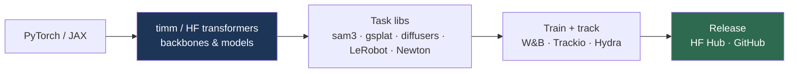

# Software Tools & Frameworks

> **Last Updated:** October 2026
> **Level:** Foundational
> **Related Sections:**
> - [PhD Study Guide](./04_phd_study_guide.md)
> - [Efficient Architectures](../09_efficiency_and_deployment/01_efficient_architectures.md)
> - [Edge Deployment](../09_efficiency_and_deployment/03_edge_deployment.md)

> **🆕 October 2026 update:**
> - Added a **version snapshot (October 2026)** checked against PyPI: PyTorch 2.14, Transformers 5.x (v5 GA in Jan 2026), timm 1.0.30, diffusers 0.41, JAX 0.11, LeRobot 0.6, Isaac Sim 6.2, MuJoCo 3.16, Newton 1.7, Genesis 1.4, Ultralytics 8.4 (YOLO26).
> - **Robotics stack:** LeRobot now ships π₀/π₀.₅, GR00T N1.7, SmolVLA, X-VLA, MolmoAct2 and world-model policies. **Newton** (Disney / Google DeepMind / NVIDIA; Linux Foundation) reached 1.0 in 2026 with MuJoCo Warp as its main solver.
> - **3D:** gsplat is still the standard Gaussian-splatting kernel library (sparse and multi-GPU rasterization on main in 2026). Feed-forward reconstruction (VGGT, MapAnything) is now a common replacement for COLMAP initialization. nerfstudio and MMDetection have had no PyPI release since 2024.
> - **Tracking:** W&B (acquired by CoreWeave in 2025) remains the default; Hugging Face's **Trackio** is a free local-first alternative. Papers With Code was sunset in July 2025, and its data is archived on Hugging Face.

---

## Overview

The productivity of a computer vision researcher is heavily mediated by a mature software stack: deep-learning frameworks, model hubs, domain-specific libraries, and experiment-tracking tools. Fluency with this ecosystem is not incidental—it determines how fast one can implement an idea, reproduce a baseline, and scale an experiment. The stack has consolidated around **PyTorch** as the dominant research framework (with JAX prominent for large-scale and TPU work), **Hugging Face** as the model/dataset distribution hub, and a constellation of task-specific libraries (timm, MMDetection, Detectron2, Open3D, nerfstudio) that package state-of-the-art implementations behind clean APIs.

A second axis is the **reproducibility and infrastructure tooling** that has become research currency in its own right: experiment trackers (Weights & Biases), versioned model hubs, and standardized data formats. Releasing clean, runnable code and pretrained weights through these channels materially increases a paper's impact and citation count (see [PhD Study Guide](./04_phd_study_guide.md)). This file surveys the core tools, what each is for, and how they fit together in a modern CV research workflow. (Tool ecosystems evolve quickly; verify current maintenance status before relying on any single library.)

---

## Deep-Learning Frameworks

- **PyTorch** — the default research framework: eager execution, dynamic graphs, vast ecosystem. `torch.compile` and FSDP/DDP (FSDP2) support large-scale training. Nearly all CV research code is PyTorch. Releases have come roughly every two months (2.9 in Oct 2025, 2.10 in Feb 2026, then 2.11–2.14 through Sept 2026), so pin the exact version in every released repository.
- **JAX** (+ Flax/Haiku) — functional, composable transforms (`grad`, `vmap`, `pmap`, `jit`); dominant for TPU and very-large-scale work (ViT-22B, much of DeepMind's stack). Steeper learning curve, excellent scaling. In 2026 it is at JAX 0.11 / Flax 0.12, and it also powers GPU-parallel simulation (MuJoCo MJX, MuJoCo Playground) used for sim-to-real RL.
- **TensorFlow / Keras** — historically dominant, now mostly in production/legacy and some Google stacks. Keras 3 (3.15 in 2026) is multi-backend (JAX/PyTorch/TF); TensorFlow releases have slowed (2.21 in Mar 2026).

## Model Hubs & Backbones

- **Hugging Face Hub** — the central repository for pretrained models, datasets, and Spaces; `transformers`, `diffusers`, `datasets`, `accelerate` libraries. The de-facto distribution channel for foundation models. **Transformers v5** (GA Jan 2026) repositions the library as the shared "model-definition" layer for training and inference engines. DINOv3, SAM 3 and the newer VLMs are supported natively.
- **timm** (PyTorch Image Models) — Ross Wightman's library of hundreds of CV backbones (ViTs, ConvNeXt, EfficientNet) with pretrained weights and a unified API; indispensable for classification/backbone baselines (see [CNN Architectures](../03_architectures/00_cnn_architectures.md)). DINOv3 backbones have been available since timm 1.0.20 (Sept 2025).

## Task-Specific Libraries

- **Detection/Segmentation** — **Detectron2** (FAIR), **MMDetection / MMSegmentation / MMCV** (OpenMMLab), **Ultralytics** (YOLO). Standard implementations and configs. Maintenance has diverged. Ultralytics is very active (8.4 / **YOLO26** in Jan 2026; YOLO27 announced as a preview). MMDetection's last release is v3.3.0 (Jan 2024), and Detectron2 is slow-moving. For segmentation, Meta's official **`sam3`** package (SAM 3 / SAM 3.1) has become the standard open-vocabulary segmentation and tracking tool.
- **3D & Rendering** — **Open3D** (point clouds/meshes; 0.20 in Sept 2026), **PyTorch3D**, **COLMAP** (SfM/MVS), **nerfstudio** (NeRF; last PyPI release 1.1.5, Nov 2024), **gsplat / 3DGS reference** (Gaussian splatting; see [Gaussian Splatting](../04_3d_vision_and_scene/02_gaussian_splatting.md)). gsplat's last tagged release is 1.5.3 (Jul 2025), but its main branch kept adding 3DGUT, sparse and multi-GPU rasterization and new camera/LiDAR models through 2026, so install from source for new features. **Feed-forward reconstruction** models (VGGT, which exports COLMAP format; MapAnything) are increasingly used to replace or initialize COLMAP (see [SfM and SLAM](../04_3d_vision_and_scene/03_sfm_and_slam.md)).
- **Generative** — **diffusers** (Hugging Face; 0.41 in Oct 2026), ComfyUI/AUTOMATIC1111 (Stable Diffusion tooling); open 3D generators such as **TRELLIS.2** (MIT-licensed, with training code) and **SAM 3D Objects** (see [3D Generation](../04_3d_vision_and_scene/04_3d_generation.md)).
- **Robotics** — **LeRobot** (Hugging Face robot-learning library), **Isaac Lab**, **MuJoCo/MJX**, **robosuite** (see [Simulation and Data](../06_robotics_and_embodied_ai/05_simulation_and_data.md)).
  - **LeRobot** went from 0.4 (Oct 2025) to 0.5 (Mar 2026) and 0.6 (Jul 2026). It now bundles imitation-learning (ACT, Diffusion, VQ-BeT), RL (HIL-SERL, TD-MPC) and VLA policies (π₀, π₀-FAST, π₀.₅, GR00T N1.7, SmolVLA, X-VLA, MolmoAct2, WALL-OSS, among others), plus early world-model policies (e.g., VLA-JEPA). This makes it the de-facto common interface for open VLAs.
  - **NVIDIA Isaac Sim / Isaac Lab:** Isaac Sim is pip-installable (6.0 in Mar 2026, 6.2 in Oct 2026); Isaac Lab 2.3.x is on PyPI.
  - **Newton** — an open, GPU-accelerated, differentiable physics engine built on NVIDIA Warp with OpenUSD support. It was initiated by Disney Research, Google DeepMind and NVIDIA, is now a Linux Foundation project, and uses **MuJoCo Warp** as its primary backend (1.0 in early 2026, 1.7 in Oct 2026).
  - **MuJoCo** (3.16, Oct 2026) with MuJoCo Warp / MJX for massively parallel GPU simulation; **Genesis** (1.0 in May 2026) as an alternative GPU simulator.

## Experiment & Reproducibility Tooling

- **Weights & Biases (W&B)** — experiment tracking, sweeps, artifact/versioning, dashboards; the most widely used tracker (acquired by CoreWeave in 2025; the product continues). **Trackio** (Hugging Face/Gradio, 2025) is a free, local-first, W&B-API-compatible alternative that logs to HF Datasets/Spaces.
- **TensorBoard**, **MLflow**, **Hydra** (config management), **DVC** (data versioning).
- **Papers With Code** — historically the standard SOTA/leaderboard tracker. Meta sunset the original site in July 2025; its data dumps (papers, code links, evaluation tables) are archived on Hugging Face (`pwc-archive`), and Hugging Face's Daily/Trending Papers took over much of its discovery role.
- **Semantic Scholar / Connected Papers / arXiv** — literature discovery and citation graphs (see [PhD Study Guide](./04_phd_study_guide.md)).

---

## Tool Comparison

| Tool | Category | Best for | Note |
|------|----------|----------|------|
| PyTorch | Framework | General research | Dominant; eager + compile |
| JAX | Framework | Large-scale/TPU | Functional; great scaling |
| Hugging Face | Hub/libs | Model/data distribution | Central ecosystem |
| timm | Backbones | Classification baselines | Hundreds of pretrained models |
| Detectron2/MMDet | Detection | Detection/segmentation | Standard configs |
| nerfstudio/gsplat | 3D | NeRF/3DGS | Reproducible 3D |
| W&B | Tracking | Experiments/sweeps | Industry standard |
| Ultralytics | Detection | Real-time YOLO training/deploy | YOLO26 (8.4); AGPL-3.0 license |
| LeRobot | Robotics | Datasets + VLA/IL/RL policies | Common interface for open VLAs |
| Isaac Lab / Newton / MuJoCo | Simulation | GPU-parallel RL, sim-to-real | Newton = LF project; MuJoCo Warp backend |

### Version Snapshot (October 2026)

| Package | Latest (PyPI, Oct 2026) | Notable 2025–2026 milestone |
|---------|-------------------------|-----------------------------|
| torch | 2.14.1 | 2.9 (Oct 2025) → 2.14 (Sept 2026), roughly bimonthly releases |
| transformers | 5.20.x | v5.0 GA on 26 Jan 2026 |
| timm | 1.0.30 | DINOv3 support from 1.0.20 |
| diffusers | 0.41.0 | 0.36 (Dec 2025) → 0.41 (Oct 2026) |
| jax / flax | 0.11.2 / 0.12.x | jax 0.8 (Oct 2025) → 0.11 (Jul 2026) |
| lerobot | 0.6.1 | 0.4 (Oct 2025), 0.5 (Mar 2026), 0.6 (Jul 2026) |
| isaacsim / isaaclab | 6.2.0 / 2.3.2 | Isaac Sim 6.0 (Mar 2026) |
| newton | 1.7.0 | 1.0 (early 2026), Linux Foundation |
| mujoco / mujoco-warp | 3.16.0 / 3.16.0 | MuJoCo Warp versioned in lockstep with MuJoCo |
| genesis-world | 1.4.x | 1.0 (May 2026) |
| gsplat | 1.5.3 (Jul 2025) | Active main branch beyond the last tag |
| ultralytics | 8.4.x | 8.4.0 / YOLO26 (Jan 2026) |
| sam3 | 0.1.x | SAM 3 (Nov 2025), SAM 3.1 checkpoints (Mar 2026) |
| wandb / trackio | 0.31 / 0.42 | Trackio launched 2025 |

*Versions change quickly; check `pip index versions <pkg>` before pinning.*

---

## Pros & Cons (framework choice)

| Aspect | PyTorch | JAX |
|--------|---------|-----|
| Ease of use | High; large community | Steeper curve |
| Scaling | Strong (FSDP, compile) | Excellent (pmap, TPU) |
| Ecosystem | Vast (timm, HF, Detectron2) | Smaller but growing |
| Debugging | Eager, intuitive | Functional, trickier |

---

## Open Problems & Research Gaps (tooling)

- **Reproducibility gaps.** Code release norms are improving but inconsistent; environment/version drift breaks reproduction.
- **Benchmark tooling fragility.** Leaderboard infrastructure (e.g., Papers With Code changes) is fragile and under-resourced.
- **Compute access.** Tooling assumes GPU/TPU access many researchers lack; democratization is incomplete.
- **Eval standardization.** No universal harness for fair CV/VLM evaluation across labs.
- **Edge/deployment gap.** Bridging research frameworks to optimized edge runtimes remains manual (see [Edge Deployment](../09_efficiency_and_deployment/03_edge_deployment.md)).
- **Robotics tooling immaturity.** Robot-learning software (LeRobot, sim interfaces) is younger and less standardized than core CV. LeRobot's policy zoo and Newton's multi-solver design are converging the stack, but checkpoint and action-space formats still differ across VLAs.
- **Abandonware risk.** Once-standard libraries (nerfstudio, MMDetection, Detectron2) have slowed or stopped releasing, while research moves to model-specific repositories (sam3, TRELLIS.2, vggt). Check a library's last release date before adopting it for a multi-year thesis.
- **Multi-backend portability.** Code written against PyTorch CUDA kernels rarely runs unmodified on TPUs, Apple Silicon, or edge NPUs, forcing per-backend rewrites that slow research iteration.
- **Dependency fragility.** Fast-moving libraries with frequent breaking changes make multi-year reproducibility difficult; pinned environments and containers help but are inconsistently adopted across the field.

---

## Further Reading

- [PyTorch](https://pytorch.org/) — the dominant research framework
- [Hugging Face Hub](https://huggingface.co/) — models, datasets, Spaces
- [timm (PyTorch Image Models)](https://github.com/huggingface/pytorch-image-models) — backbone library
- [nerfstudio](https://docs.nerf.studio/) — NeRF/3DGS toolkit
- [Weights & Biases](https://wandb.ai/) — experiment tracking
- [Trackio](https://github.com/gradio-app/trackio) — lightweight, local-first tracker on Hugging Face
- [LeRobot](https://huggingface.co/docs/lerobot/index) — robot-learning datasets and policies (VLAs, IL, RL)
- [gsplat](https://github.com/nerfstudio-project/gsplat) — CUDA Gaussian-splatting rasterization library
- [Newton](https://github.com/newton-physics/newton) — open GPU physics engine (Linux Foundation)
- [SAM 3](https://github.com/facebookresearch/sam3) — official SAM 3 / SAM 3.1 code and checkpoints
